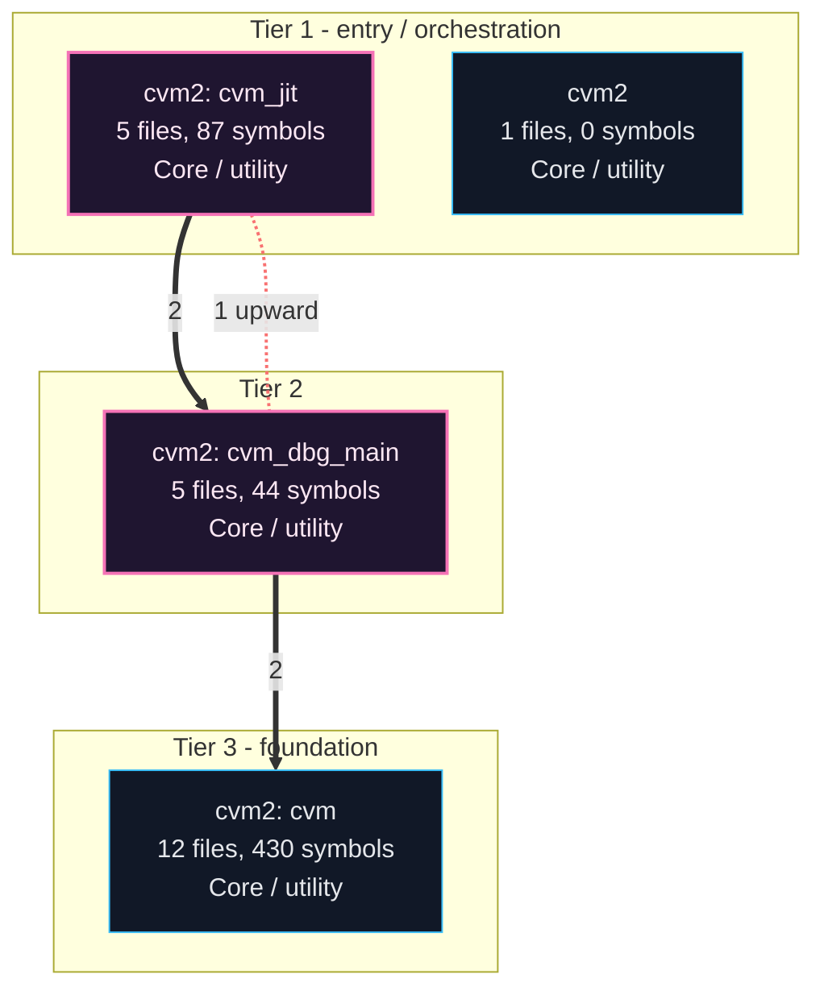
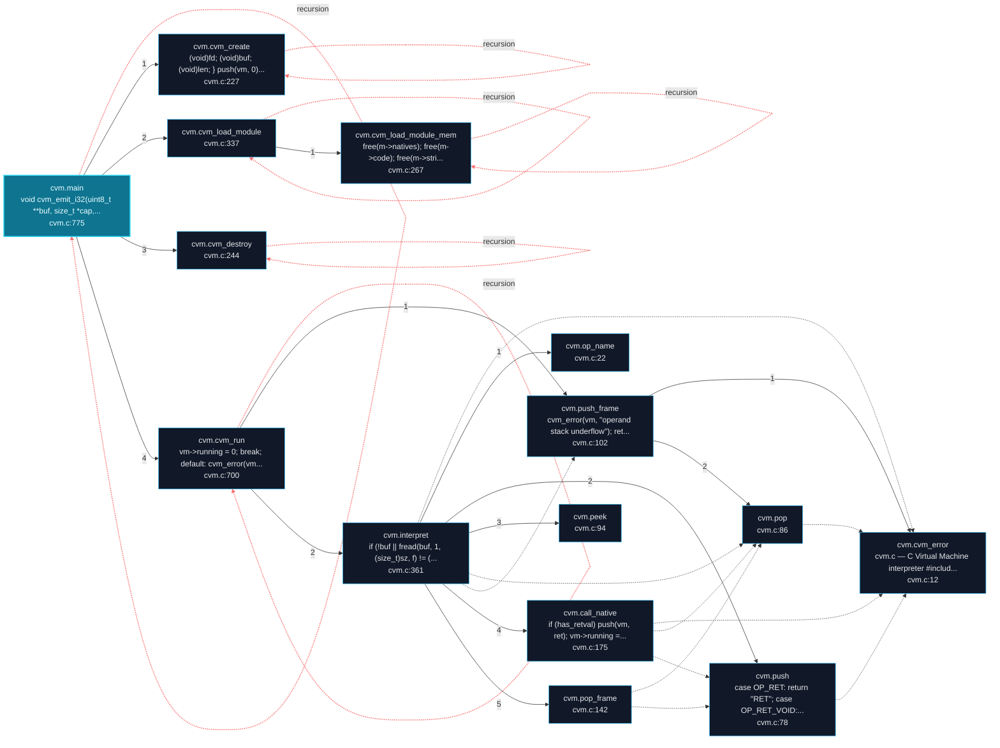
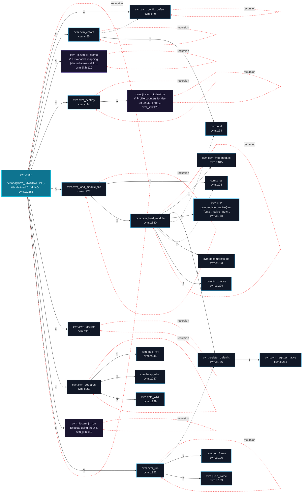
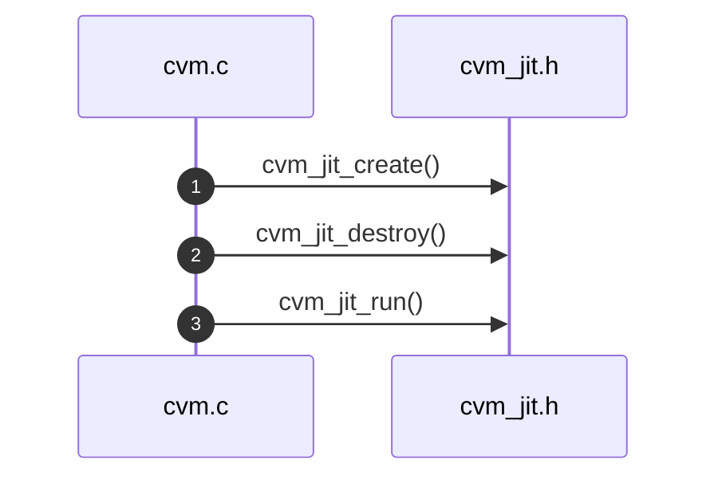
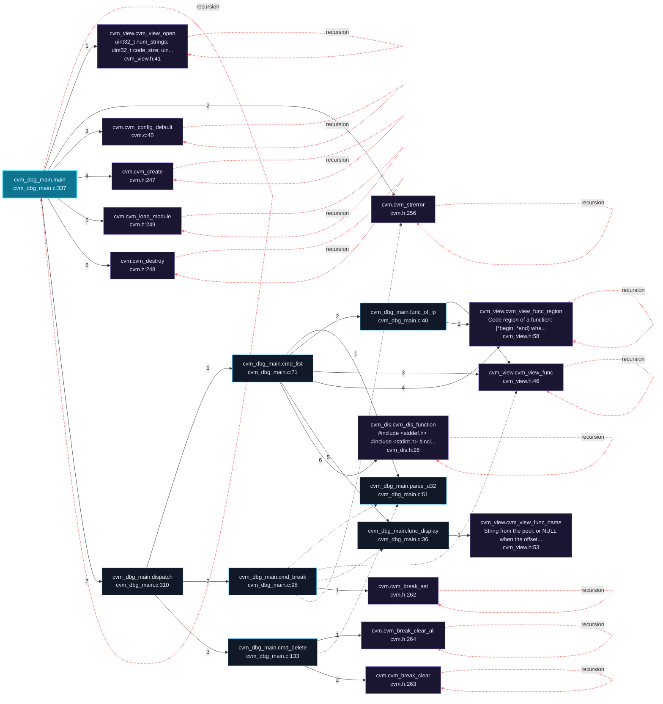
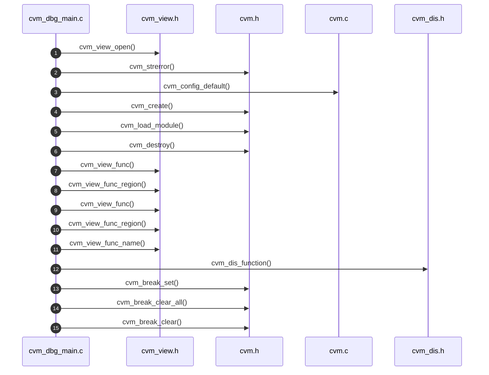

# cvm Architecture and Execution Flows

[Back to index](index.md)

## Architecture Overview

4 components stacked in 3 dependency tiers (weighted Eades-Lin-Smyth ordering: arrows point from dependent to dependency, top to bottom). Labels are import counts, thick arrows the top quartile; 1 transitively implied edges are omitted. Dashed red arrows are upward dependencies: the smallest set of imports that closes every cycle and breaks the layering. Cyan components hold entry points. Interactive version: `readmenator-apidocs/index.html#/flows`.

Upward dependencies to fix first: `cvm2: cvm_dbg_main` -> `cvm2: cvm_jit` (1 imports)

---

## Execution Flows

Entry points are scored from `__main__` guards, `main` functions, entry-style names and files, and call-graph sources. Each flow walks resolved calls in call-site order (depth <= 4, <= 40 steps); numbers give the call order, dashed arrows revisit an already expanded callee, red arrows are recursion. Interactive version with zoom and per-node docs: `readmenator-apidocs/index.html#/flows`.

### `cvm.main`

`cvm.c:775`, score 11: `main` in a compiled-language file; entry-style name `main`.

Call tree:

### `cvm.main`

`cvm2/cvm.c:1355`, score 11: `main` in a compiled-language file; entry-style name `main`.

Call tree:

Cross-file sequence:

### `cvm_dbg_main.main`

`cvm2/cvm_dbg_main.c:337`, score 11: `main` in a compiled-language file; entry-style name `main`.

Call tree:

Cross-file sequence:

---
