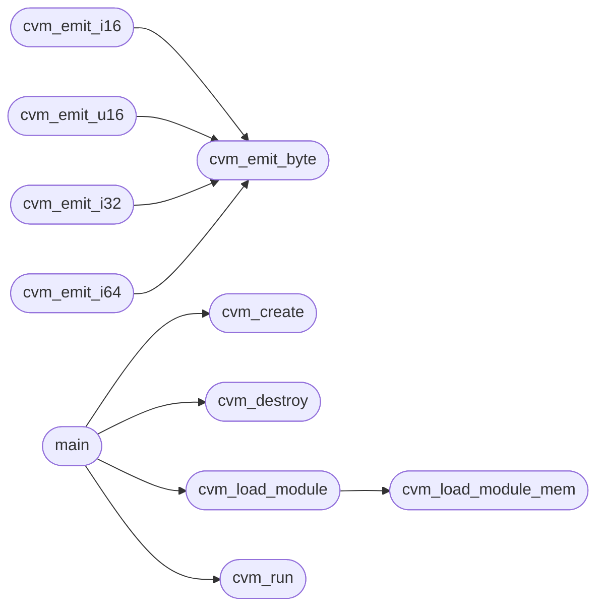

# `cvm.c`

> Source: [cvm.c:1](../../cvm.c#L1) | language `c` | coverage 41.7% | [API index](../index.md)

## Contents

- **Functions:** [`cvm_create`](#cvm_create), [`cvm_destroy`](#cvm_destroy), [`cvm_load_module_mem`](#cvm_load_module_mem), [`cvm_load_module`](#cvm_load_module), [`cvm_run`](#cvm_run), [`cvm_emit_byte`](#cvm_emit_byte), [`cvm_emit_i16`](#cvm_emit_i16), [`cvm_emit_u16`](#cvm_emit_u16), [`cvm_emit_i32`](#cvm_emit_i32), [`cvm_emit_i64`](#cvm_emit_i64), [`main`](#main)

## Call Graph

Solid arrows stay in this module, dashed arrows leave it.



## Functions

<a id="cvm_create"></a>

### `cvm_create`

`function` | [cvm.c:227](../../cvm.c#L227)

```c
CVM *cvm_create(void)
```

(void)fd; (void)buf; (void)len; } push(vm, 0); return; } /* generic: just pop args and push 0 for (int i = 0; i < argc; i++) pop(vm); push(vm, 0); } /* ------------------------------------------------------------------ /*  Create / destroy /* ------------------------------------------------------------------

**Returns:** `CVM *`

*Called by:* [`main`](#main)

---

<a id="cvm_destroy"></a>

### `cvm_destroy`

`function` | [cvm.c:244](../../cvm.c#L244)

```c
void cvm_destroy(CVM *vm)
```

**Parameters**

| Name | Type | Default | Description |
|---|---|---|---|
| `vm` | `CVM *` |  |  |

*Called by:* [`main`](#main)

---

<a id="cvm_load_module_mem"></a>

### `cvm_load_module_mem`

`function` | [cvm.c:267](../../cvm.c#L267)

```c
int cvm_load_module_mem(CVM *vm, const uint8_t *data, size_t size, const char *name)
```

free(m->natives); free(m->code); free(m->string_pool); free(m->global_mem); free(m); } free(vm->stack); free(vm->heap); free(vm); } /* ------------------------------------------------------------------ /*  Load module from memory /* ------------------------------------------------------------------

**Parameters**

| Name | Type | Default | Description |
|---|---|---|---|
| `vm` | `CVM *` |  |  |
| `data` | `uint8_t *` |  |  |
| `size` | `size_t` |  |  |
| `name` | `char *` |  |  |

**Returns:** `int`

*Called by:* [`cvm_load_module`](#cvm_load_module)

---

<a id="cvm_load_module"></a>

### `cvm_load_module`

`function` | [cvm.c:337](../../cvm.c#L337)

```c
int cvm_load_module(CVM *vm, const char *path)
```

**Parameters**

| Name | Type | Default | Description |
|---|---|---|---|
| `vm` | `CVM *` |  |  |
| `path` | `char *` |  |  |

**Returns:** `int`

*Calls:* [`cvm_load_module_mem`](#cvm_load_module_mem)

*Called by:* [`main`](#main)

---

<a id="cvm_run"></a>

### `cvm_run`

`function` | [cvm.c:700](../../cvm.c#L700)

```c
int cvm_run(CVM *vm, const char *entry_name)
```

vm->running = 0; break; default: cvm_error(vm, "unknown opcode 0x%02x at ip=%u", op, vm->ip - 1); break; } } return 0; } /* ------------------------------------------------------------------ /*  Public run /* ------------------------------------------------------------------

**Parameters**

| Name | Type | Default | Description |
|---|---|---|---|
| `vm` | `CVM *` |  |  |
| `entry_name` | `char *` |  |  |

**Returns:** `int`

*Called by:* [`main`](#main)

---

<a id="cvm_emit_byte"></a>

### `cvm_emit_byte`

`function` | [cvm.c:743](../../cvm.c#L743)

```c
void cvm_emit_byte(uint8_t **buf, size_t *cap, size_t *len, uint8_t b)
```

if (vm->trace) fprintf(stderr, "Finished. instructions = %llu\n", (unsigned long long)vm->instr_count); /* if there is a return value left on the stack, return it as exit code if (vm->sp > 0) return (int)(int64_t)vm->stack[vm->sp - 1]; return 0; } /* ------------------------------------------------------------------ /*  Emitter helpers (used by the backend) /* ------------------------------------------------------------------

**Parameters**

| Name | Type | Default | Description |
|---|---|---|---|
| `buf` | `uint8_t **` |  |  |
| `cap` | `size_t *` |  |  |
| `len` | `size_t *` |  |  |
| `b` | `uint8_t` |  |  |

*Called by:* [`cvm_emit_i16`](#cvm_emit_i16), [`cvm_emit_i32`](#cvm_emit_i32), [`cvm_emit_i64`](#cvm_emit_i64), [`cvm_emit_u16`](#cvm_emit_u16)

---

<a id="cvm_emit_i16"></a>

### `cvm_emit_i16`

`function` | [cvm.c:751](../../cvm.c#L751)

```c
void cvm_emit_i16(uint8_t **buf, size_t *cap, size_t *len, int16_t v)
```

**Parameters**

| Name | Type | Default | Description |
|---|---|---|---|
| `buf` | `uint8_t **` |  |  |
| `cap` | `size_t *` |  |  |
| `len` | `size_t *` |  |  |
| `v` | `int16_t` |  |  |

*Calls:* [`cvm_emit_byte`](#cvm_emit_byte)

---

<a id="cvm_emit_u16"></a>

### `cvm_emit_u16`

`function` | [cvm.c:756](../../cvm.c#L756)

```c
void cvm_emit_u16(uint8_t **buf, size_t *cap, size_t *len, uint16_t v)
```

**Parameters**

| Name | Type | Default | Description |
|---|---|---|---|
| `buf` | `uint8_t **` |  |  |
| `cap` | `size_t *` |  |  |
| `len` | `size_t *` |  |  |
| `v` | `uint16_t` |  |  |

*Calls:* [`cvm_emit_byte`](#cvm_emit_byte)

---

<a id="cvm_emit_i32"></a>

### `cvm_emit_i32`

`function` | [cvm.c:761](../../cvm.c#L761)

```c
void cvm_emit_i32(uint8_t **buf, size_t *cap, size_t *len, int32_t v)
```

**Parameters**

| Name | Type | Default | Description |
|---|---|---|---|
| `buf` | `uint8_t **` |  |  |
| `cap` | `size_t *` |  |  |
| `len` | `size_t *` |  |  |
| `v` | `int32_t` |  |  |

*Calls:* [`cvm_emit_byte`](#cvm_emit_byte)

---

<a id="cvm_emit_i64"></a>

### `cvm_emit_i64`

`function` | [cvm.c:766](../../cvm.c#L766)

```c
void cvm_emit_i64(uint8_t **buf, size_t *cap, size_t *len, int64_t v)
```

**Parameters**

| Name | Type | Default | Description |
|---|---|---|---|
| `buf` | `uint8_t **` |  |  |
| `cap` | `size_t *` |  |  |
| `len` | `size_t *` |  |  |
| `v` | `int64_t` |  |  |

*Calls:* [`cvm_emit_byte`](#cvm_emit_byte)

---

<a id="main"></a>

### `main`

`function` | [cvm.c:775](../../cvm.c#L775)

```c
int main(int argc, char **argv)
```

void cvm_emit_i32(uint8_t **buf, size_t *cap, size_t *len, int32_t v) { for (int i = 0; i < 4; i++) cvm_emit_byte(buf, cap, len, (uint8_t)((v >> (i * 8)) & 0xff)); } void cvm_emit_i64(uint8_t **buf, size_t *cap, size_t *len, int64_t v) { for (int i = 0; i < 8; i++) cvm_emit_byte(buf, cap, len, (uint8_t)((v >> (i * 8)) & 0xff)); } /* ------------------------------------------------------------------ /*  Main (standalone runner) /* ------------------------------------------------------------------ ifdef CVM_STANDALONE

**Parameters**

| Name | Type | Default | Description |
|---|---|---|---|
| `argc` | `int` |  |  |
| `argv` | `char **` |  |  |

**Returns:** `int`

*Calls:* [`cvm_create`](#cvm_create), [`cvm_destroy`](#cvm_destroy), [`cvm_load_module`](#cvm_load_module), [`cvm_run`](#cvm_run)

---
