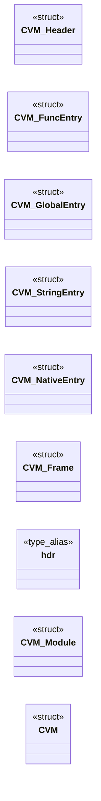

# `cvm.h`

> Source: [cvm.h:1](../../cvm.h#L1) | language `h` | coverage 17.9% | [API index](../index.md)

## Contents

- **Structs:** [`CVM_Header`](#cvm_header), [`CVM_FuncEntry`](#cvm_funcentry), [`CVM_GlobalEntry`](#cvm_globalentry), [`CVM_StringEntry`](#cvm_stringentry), [`CVM_NativeEntry`](#cvm_nativeentry), [`CVM_Frame`](#cvm_frame), [`CVM_Module`](#cvm_module), [`CVM`](#cvm)
- **Type Aliases:** [`hdr`](#hdr)
- **Functions:** [`cvm_create`](#cvm_create), [`cvm_destroy`](#cvm_destroy), [`cvm_load_module`](#cvm_load_module), [`cvm_load_module_mem`](#cvm_load_module_mem), [`cvm_run`](#cvm_run), [`cvm_call`](#cvm_call), [`cvm_emit_byte`](#cvm_emit_byte), [`cvm_emit_i16`](#cvm_emit_i16), [`cvm_emit_i32`](#cvm_emit_i32), [`cvm_emit_i64`](#cvm_emit_i64), [`cvm_emit_u16`](#cvm_emit_u16)
- **Macros:** [`CVM_MAGIC`](#cvm_magic), [`CVM_VERSION`](#cvm_version), [`CVM_STACK_SIZE`](#cvm_stack_size), [`CVM_FRAME_DEPTH`](#cvm_frame_depth), [`CVM_HEAP_SIZE`](#cvm_heap_size), [`CVM_MAX_MODULES`](#cvm_max_modules), [`CVM_MAX_NATIVES`](#cvm_max_natives)

## Type Diagram



## Structs

<a id="cvm_header"></a>

### `CVM_Header`

`struct` | [cvm.h:107](../../cvm.h#L107)

```c
typedef struct
```

/* Heap OP_ALLOC        = 0x80,   /* size on stack → ptr OP_FREE         = 0x81, /* Syscalls / misc OP_SYSCALL      = 0x90,   /* nr, arg0..arg5 on stack (Linux x86-64 style) OP_PRINT_I64    = 0x91,   /* debug helper OP_HALT         = 0xFF }; /* ------------------------------------------------------------------ /*  Module format (on disk / in memory) /* ------------------------------------------------------------------ pragma pack(push, 1)

---

<a id="cvm_funcentry"></a>

### `CVM_FuncEntry`

`struct` | [cvm.h:126](../../cvm.h#L126)

```c
typedef struct
```

---

<a id="cvm_globalentry"></a>

### `CVM_GlobalEntry`

`struct` | [cvm.h:136](../../cvm.h#L136)

```c
typedef struct
```

---

<a id="cvm_stringentry"></a>

### `CVM_StringEntry`

`struct` | [cvm.h:142](../../cvm.h#L142)

```c
typedef struct
```

---

<a id="cvm_nativeentry"></a>

### `CVM_NativeEntry`

`struct` | [cvm.h:147](../../cvm.h#L147)

```c
typedef struct
```

---

<a id="cvm_frame"></a>

### `CVM_Frame`

`struct` | [cvm.h:161](../../cvm.h#L161)

```c
typedef struct
```

---

<a id="cvm_module"></a>

### `CVM_Module`

`struct` | [cvm.h:169](../../cvm.h#L169)

```c
typedef struct CVM_Module
```

---

<a id="cvm"></a>

### `CVM`

`struct` | [cvm.h:182](../../cvm.h#L182)

```c
typedef struct
```

---

## Type Aliases

<a id="hdr"></a>

### `hdr`

`type_alias` | [cvm.h:168](../../cvm.h#L168)

```c
typedef struct CVM_Module { CVM_Header hdr;
```

---

## Functions

<a id="cvm_create"></a>

### `cvm_create`

`function` | [cvm.h:215](../../cvm.h#L215)

```c
CVM *cvm_create(void);
```

/* Heap (bump allocator for simplicity) uint8_t    *heap; size_t      heap_used; size_t      heap_size; /* Stats / debug uint64_t    instr_count; int         running; int         trace; } CVM; /* ------------------------------------------------------------------ /*  Public API /* ------------------------------------------------------------------

**Returns:** `CVM *`

---

<a id="cvm_destroy"></a>

### `cvm_destroy`

`function` | [cvm.h:216](../../cvm.h#L216)

```c
void cvm_destroy(CVM *vm);
```

**Parameters**

| Name | Type | Default | Description |
|---|---|---|---|
| `vm` | `CVM *` |  |  |

---

<a id="cvm_load_module"></a>

### `cvm_load_module`

`function` | [cvm.h:217](../../cvm.h#L217)

```c
int cvm_load_module(CVM *vm, const char *path);
```

**Parameters**

| Name | Type | Default | Description |
|---|---|---|---|
| `vm` | `CVM *` |  |  |
| `path` | `char *` |  |  |

**Returns:** `int`

---

<a id="cvm_load_module_mem"></a>

### `cvm_load_module_mem`

`function` | [cvm.h:218](../../cvm.h#L218)

```c
int cvm_load_module_mem(CVM *vm, const uint8_t *data, size_t size, const char *name);
```

**Parameters**

| Name | Type | Default | Description |
|---|---|---|---|
| `vm` | `CVM *` |  |  |
| `data` | `uint8_t *` |  |  |
| `size` | `size_t` |  |  |
| `name` | `char *` |  |  |

**Returns:** `int`

---

<a id="cvm_run"></a>

### `cvm_run`

`function` | [cvm.h:219](../../cvm.h#L219)

```c
int cvm_run(CVM *vm, const char *entry_name);
```

**Parameters**

| Name | Type | Default | Description |
|---|---|---|---|
| `vm` | `CVM *` |  |  |
| `entry_name` | `char *` |  |  |

**Returns:** `int`

---

<a id="cvm_call"></a>

### `cvm_call`

`function` | [cvm.h:220](../../cvm.h#L220)

```c
int cvm_call(CVM *vm, int module_idx, int func_idx, int argc, uint64_t *args);
```

**Parameters**

| Name | Type | Default | Description |
|---|---|---|---|
| `vm` | `CVM *` |  |  |
| `module_idx` | `int` |  |  |
| `func_idx` | `int` |  |  |
| `argc` | `int` |  |  |
| `args` | `uint64_t *` |  |  |

**Returns:** `int`

---

<a id="cvm_emit_byte"></a>

### `cvm_emit_byte`

`function` | [cvm.h:223](../../cvm.h#L223)

```c
void cvm_emit_byte(uint8_t **buf, size_t *cap, size_t *len, uint8_t b);
```

Helpers used by the backend emitter

**Parameters**

| Name | Type | Default | Description |
|---|---|---|---|
| `buf` | `uint8_t **` |  |  |
| `cap` | `size_t *` |  |  |
| `len` | `size_t *` |  |  |
| `b` | `uint8_t` |  |  |

*Called by:* [`main`](gen_fib_cvm.c.md#main)

---

<a id="cvm_emit_i16"></a>

### `cvm_emit_i16`

`function` | [cvm.h:224](../../cvm.h#L224)

```c
void cvm_emit_i16 (uint8_t **buf, size_t *cap, size_t *len, int16_t v);
```

**Parameters**

| Name | Type | Default | Description |
|---|---|---|---|
| `buf` | `uint8_t **` |  |  |
| `cap` | `size_t *` |  |  |
| `len` | `size_t *` |  |  |
| `v` | `int16_t` |  |  |

*Called by:* [`main`](gen_fib_cvm.c.md#main)

---

<a id="cvm_emit_i32"></a>

### `cvm_emit_i32`

`function` | [cvm.h:225](../../cvm.h#L225)

```c
void cvm_emit_i32 (uint8_t **buf, size_t *cap, size_t *len, int32_t v);
```

**Parameters**

| Name | Type | Default | Description |
|---|---|---|---|
| `buf` | `uint8_t **` |  |  |
| `cap` | `size_t *` |  |  |
| `len` | `size_t *` |  |  |
| `v` | `int32_t` |  |  |

*Called by:* [`main`](gen_fib_cvm.c.md#main)

---

<a id="cvm_emit_i64"></a>

### `cvm_emit_i64`

`function` | [cvm.h:226](../../cvm.h#L226)

```c
void cvm_emit_i64 (uint8_t **buf, size_t *cap, size_t *len, int64_t v);
```

**Parameters**

| Name | Type | Default | Description |
|---|---|---|---|
| `buf` | `uint8_t **` |  |  |
| `cap` | `size_t *` |  |  |
| `len` | `size_t *` |  |  |
| `v` | `int64_t` |  |  |

---

<a id="cvm_emit_u16"></a>

### `cvm_emit_u16`

`function` | [cvm.h:227](../../cvm.h#L227)

```c
void cvm_emit_u16 (uint8_t **buf, size_t *cap, size_t *len, uint16_t v);
```

**Parameters**

| Name | Type | Default | Description |
|---|---|---|---|
| `buf` | `uint8_t **` |  |  |
| `cap` | `size_t *` |  |  |
| `len` | `size_t *` |  |  |
| `v` | `uint16_t` |  |  |

*Called by:* [`main`](gen_fib_cvm.c.md#main)

---

## Macros

<a id="cvm_magic"></a>

### `CVM_MAGIC`

`macro` | [cvm.h:22](../../cvm.h#L22)

```c
#define CVM_MAGIC
```

---

<a id="cvm_version"></a>

### `CVM_VERSION`

`macro` | [cvm.h:23](../../cvm.h#L23)

```c
#define CVM_VERSION
```

'CVM1' little-endian

---

<a id="cvm_stack_size"></a>

### `CVM_STACK_SIZE`

`macro` | [cvm.h:155](../../cvm.h#L155)

```c
#define CVM_STACK_SIZE
```

---

<a id="cvm_frame_depth"></a>

### `CVM_FRAME_DEPTH`

`macro` | [cvm.h:156](../../cvm.h#L156)

```c
#define CVM_FRAME_DEPTH
```

64k slots

---

<a id="cvm_heap_size"></a>

### `CVM_HEAP_SIZE`

`macro` | [cvm.h:157](../../cvm.h#L157)

```c
#define CVM_HEAP_SIZE
```

---

<a id="cvm_max_modules"></a>

### `CVM_MAX_MODULES`

`macro` | [cvm.h:158](../../cvm.h#L158)

```c
#define CVM_MAX_MODULES
```

---

<a id="cvm_max_natives"></a>

### `CVM_MAX_NATIVES`

`macro` | [cvm.h:159](../../cvm.h#L159)

```c
#define CVM_MAX_NATIVES
```

---
