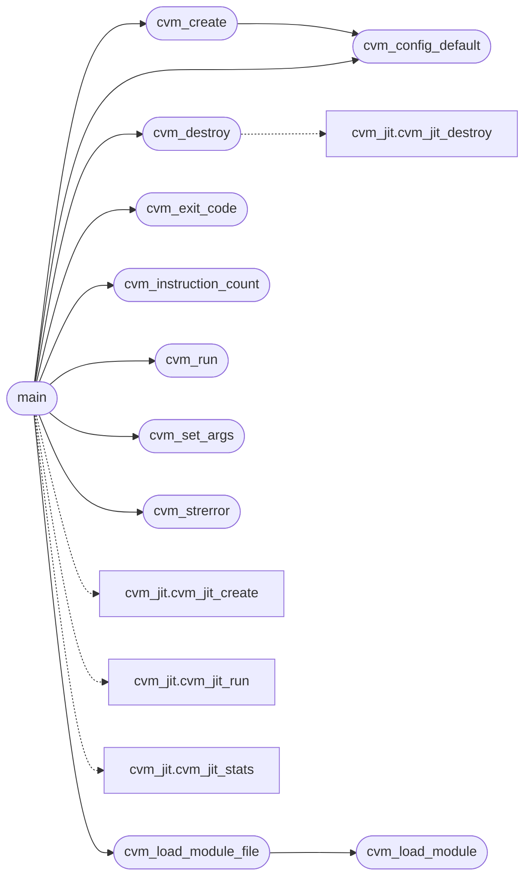

# `cvm2/cvm.c`

> Source: [cvm2/cvm.c:1](../../cvm2/cvm.c#L1) | language `c` | coverage 14.3% | [API index](../index.md)

## Contents

- **Structs:** [`Vout`](#vout)
- **Functions:** [`cvm_config_default`](#cvm_config_default), [`cvm_create`](#cvm_create), [`cvm_destroy`](#cvm_destroy), [`cvm_strerror`](#cvm_strerror), [`cvm_heap_alloc`](#cvm_heap_alloc), [`cvm_set_args`](#cvm_set_args), [`cvm_register_native`](#cvm_register_native), [`cvm_load_module`](#cvm_load_module), [`cvm_load_module_file`](#cvm_load_module_file), [`cvm_run`](#cvm_run), [`cvm_continue`](#cvm_continue), [`cvm_break_set`](#cvm_break_set), [`cvm_break_clear`](#cvm_break_clear), [`cvm_break_clear_all`](#cvm_break_clear_all), [`cvm_break_hit`](#cvm_break_hit), [`cvm_profile_begin`](#cvm_profile_begin), [`cvm_profile_end`](#cvm_profile_end), [`cvm_step`](#cvm_step), [`cvm_exit_code`](#cvm_exit_code), [`cvm_instruction_count`](#cvm_instruction_count), [`main`](#main)
- **Macros:** [`CVM_DEF_STACK`](#cvm_def_stack), [`CVM_DEF_FRAMES`](#cvm_def_frames), [`CVM_DEF_LOCALS`](#cvm_def_locals), [`CVM_DEF_HEAP`](#cvm_def_heap), [`CVM_DEF_GLOBALS`](#cvm_def_globals), [`CVM_DEF_FUNCS`](#cvm_def_funcs), [`CVM_DEF_NATIVES`](#cvm_def_natives), [`CVM_DEF_CODE`](#cvm_def_code), [`CVM_DEF_PROFILE`](#cvm_def_profile), [`CVM_HEAP_ALIGN`](#cvm_heap_align), [`CVM_MAX_NARGS`](#cvm_max_nargs), [`CVM_MAX_SARGS`](#cvm_max_sargs)

## Call Graph

Solid arrows stay in this module, dashed arrows leave it.



## Structs

<a id="vout"></a>

### `Vout`

`struct` | [cvm2/cvm.c:465](../../cvm2/cvm.c#L465)

```c
typedef struct
```

---- mini printf engine ----

---

## Functions

<a id="cvm_config_default"></a>

### `cvm_config_default`

`function` | [cvm2/cvm.c:40](../../cvm2/cvm.c#L40)

```c
CvmConfig cvm_config_default(void)
```

**Returns:** `CvmConfig`

*Called by:* [`cvm_create`](#cvm_create), [`main`](#main), [`main`](cvm2.cvm_dbg_main.c.md#main), [`main`](cvm2.gen_fib_cvm.c.md#main), [`main`](cvm2.gen_minimal.c.md#main)

---

<a id="cvm_create"></a>

### `cvm_create`

`function` | [cvm2/cvm.c:55](../../cvm2/cvm.c#L55)

```c
CvmState *cvm_create(const CvmConfig *config)
```

/* Heap (bump allocator for simplicity) uint8_t    *heap; size_t      heap_used; size_t      heap_size; /* Stats / debug uint64_t    instr_count; int         running; int         trace; } CVM; /* ------------------------------------------------------------------ /*  Public API /* ------------------------------------------------------------------

**Parameters**

| Name | Type | Default | Description |
|---|---|---|---|
| `config` | `CvmConfig *` |  |  |

**Returns:** `CvmState *`

> **Inherited:** Documentation from [`cvm_create`](#cvm_create) (cvm.h:215).

*Calls:* [`cvm_config_default`](#cvm_config_default)

*Called by:* [`main`](#main)

---

<a id="cvm_destroy"></a>

### `cvm_destroy`

`function` | [cvm2/cvm.c:94](../../cvm2/cvm.c#L94)

```c
void cvm_destroy(CvmState *vm)
```

**Parameters**

| Name | Type | Default | Description |
|---|---|---|---|
| `vm` | `CvmState *` |  |  |

*Calls:* [`cvm_jit_destroy`](cvm2.cvm_jit.h.md#cvm_jit_destroy)

*Called by:* [`main`](#main)

---

<a id="cvm_strerror"></a>

### `cvm_strerror`

`function` `const` | [cvm2/cvm.c:113](../../cvm2/cvm.c#L113)

```c
const char *cvm_strerror(int e)
```

**Parameters**

| Name | Type | Default | Description |
|---|---|---|---|
| `e` | `int` |  |  |

**Returns:** `char *`

*Called by:* [`main`](#main)

---

<a id="cvm_heap_alloc"></a>

### `cvm_heap_alloc`

`function` | [cvm2/cvm.c:235](../../cvm2/cvm.c#L235)

```c
void *cvm_heap_alloc(CvmState *vm, size_t size)
```

**Parameters**

| Name | Type | Default | Description |
|---|---|---|---|
| `vm` | `CvmState *` |  |  |
| `size` | `size_t` |  |  |

**Returns:** `void *`

---

<a id="cvm_set_args"></a>

### `cvm_set_args`

`function` | [cvm2/cvm.c:250](../../cvm2/cvm.c#L250)

```c
int cvm_set_args(CvmState *vm, int argc, char **argv)
```

**Parameters**

| Name | Type | Default | Description |
|---|---|---|---|
| `vm` | `CvmState *` |  |  |
| `argc` | `int` |  |  |
| `argv` | `char **` |  |  |

**Returns:** `int`

*Called by:* [`main`](#main)

---

<a id="cvm_register_native"></a>

### `cvm_register_native`

`function` | [cvm2/cvm.c:283](../../cvm2/cvm.c#L283)

```c
int cvm_register_native(CvmState *vm, const char *name, CvmNativeFn fn)
```

**Parameters**

| Name | Type | Default | Description |
|---|---|---|---|
| `vm` | `CvmState *` |  |  |
| `name` | `char *` |  |  |
| `fn` | `CvmNativeFn` |  |  |

**Returns:** `int`

---

<a id="cvm_load_module"></a>

### `cvm_load_module`

`function` | [cvm2/cvm.c:830](../../cvm2/cvm.c#L830)

```c
int cvm_load_module(CvmState *vm, const uint8_t *d, size_t sz)
```

**Parameters**

| Name | Type | Default | Description |
|---|---|---|---|
| `vm` | `CvmState *` |  |  |
| `d` | `uint8_t *` |  |  |
| `sz` | `size_t` |  |  |

**Returns:** `int`

*Called by:* [`cvm_load_module_file`](#cvm_load_module_file)

---

<a id="cvm_load_module_file"></a>

### `cvm_load_module_file`

`function` | [cvm2/cvm.c:923](../../cvm2/cvm.c#L923)

```c
int cvm_load_module_file(CvmState *vm, const char *path)
```

**Parameters**

| Name | Type | Default | Description |
|---|---|---|---|
| `vm` | `CvmState *` |  |  |
| `path` | `char *` |  |  |

**Returns:** `int`

*Calls:* [`cvm_load_module`](#cvm_load_module)

*Called by:* [`main`](#main)

---

<a id="cvm_run"></a>

### `cvm_run`

`function` | [cvm2/cvm.c:952](../../cvm2/cvm.c#L952)

```c
int cvm_run(CvmState *vm)
```

**Parameters**

| Name | Type | Default | Description |
|---|---|---|---|
| `vm` | `CvmState *` |  |  |

**Returns:** `int`

*Called by:* [`main`](#main)

---

<a id="cvm_continue"></a>

### `cvm_continue`

`function` | [cvm2/cvm.c:990](../../cvm2/cvm.c#L990)

```c
int cvm_continue(CvmState *vm)
```

Run after a breakpoint: same loop, no state reset.

**Parameters**

| Name | Type | Default | Description |
|---|---|---|---|
| `vm` | `CvmState *` |  |  |

**Returns:** `int`

---

<a id="cvm_break_set"></a>

### `cvm_break_set`

`function` | [cvm2/cvm.c:994](../../cvm2/cvm.c#L994)

```c
int cvm_break_set(CvmState *vm, size_t ip)
```

**Parameters**

| Name | Type | Default | Description |
|---|---|---|---|
| `vm` | `CvmState *` |  |  |
| `ip` | `size_t` |  |  |

**Returns:** `int`

---

<a id="cvm_break_clear"></a>

### `cvm_break_clear`

`function` | [cvm2/cvm.c:1003](../../cvm2/cvm.c#L1003)

```c
int cvm_break_clear(CvmState *vm, size_t ip)
```

**Parameters**

| Name | Type | Default | Description |
|---|---|---|---|
| `vm` | `CvmState *` |  |  |
| `ip` | `size_t` |  |  |

**Returns:** `int`

---

<a id="cvm_break_clear_all"></a>

### `cvm_break_clear_all`

`function` | [cvm2/cvm.c:1014](../../cvm2/cvm.c#L1014)

```c
void cvm_break_clear_all(CvmState *vm)
```

**Parameters**

| Name | Type | Default | Description |
|---|---|---|---|
| `vm` | `CvmState *` |  |  |

---

<a id="cvm_break_hit"></a>

### `cvm_break_hit`

`function` | [cvm2/cvm.c:1018](../../cvm2/cvm.c#L1018)

```c
int cvm_break_hit(const CvmState *vm)
```

**Parameters**

| Name | Type | Default | Description |
|---|---|---|---|
| `vm` | `CvmState *` |  |  |

**Returns:** `int`

---

<a id="cvm_profile_begin"></a>

### `cvm_profile_begin`

`function` | [cvm2/cvm.c:1024](../../cvm2/cvm.c#L1024)

```c
int cvm_profile_begin(CvmState *vm)
```

**Parameters**

| Name | Type | Default | Description |
|---|---|---|---|
| `vm` | `CvmState *` |  |  |

**Returns:** `int`

---

<a id="cvm_profile_end"></a>

### `cvm_profile_end`

`function` | [cvm2/cvm.c:1034](../../cvm2/cvm.c#L1034)

```c
void cvm_profile_end(CvmState *vm)
```

**Parameters**

| Name | Type | Default | Description |
|---|---|---|---|
| `vm` | `CvmState *` |  |  |

---

<a id="cvm_step"></a>

### `cvm_step`

`function` | [cvm2/cvm.c:1039](../../cvm2/cvm.c#L1039)

```c
int cvm_step(CvmState *vm)
```

Execute exactly one instruction at vm->ip.

**Parameters**

| Name | Type | Default | Description |
|---|---|---|---|
| `vm` | `CvmState *` |  |  |

**Returns:** `int`

---

<a id="cvm_exit_code"></a>

### `cvm_exit_code`

`function` | [cvm2/cvm.c:1351](../../cvm2/cvm.c#L1351)

```c
int64_t cvm_exit_code(const CvmState *vm)
```

**Parameters**

| Name | Type | Default | Description |
|---|---|---|---|
| `vm` | `CvmState *` |  |  |

**Returns:** `int64_t`

*Called by:* [`main`](#main)

---

<a id="cvm_instruction_count"></a>

### `cvm_instruction_count`

`function` | [cvm2/cvm.c:1352](../../cvm2/cvm.c#L1352)

```c
uint64_t cvm_instruction_count(const CvmState *vm)
```

**Parameters**

| Name | Type | Default | Description |
|---|---|---|---|
| `vm` | `CvmState *` |  |  |

**Returns:** `uint64_t`

*Called by:* [`main`](#main)

---

<a id="main"></a>

### `main`

`function` | [cvm2/cvm.c:1355](../../cvm2/cvm.c#L1355)

```c
int main(int argc, char *argv[])
```

if defined(CVM_STANDALONE) && !defined(CVM_NO_MAIN)

**Parameters**

| Name | Type | Default | Description |
|---|---|---|---|
| `argc` | `int` |  |  |
| `argv` | `char * []` |  |  |

**Returns:** `int`

*Calls:* [`cvm_config_default`](#cvm_config_default), [`cvm_create`](#cvm_create), [`cvm_destroy`](#cvm_destroy), [`cvm_exit_code`](#cvm_exit_code), [`cvm_instruction_count`](#cvm_instruction_count), [`cvm_load_module_file`](#cvm_load_module_file), [`cvm_run`](#cvm_run), [`cvm_set_args`](#cvm_set_args), [`cvm_strerror`](#cvm_strerror), [`cvm_jit_create`](cvm2.cvm_jit.h.md#cvm_jit_create), [`cvm_jit_run`](cvm2.cvm_jit.h.md#cvm_jit_run), [`cvm_jit_stats`](cvm2.cvm_jit.h.md#cvm_jit_stats)

---

## Macros

<a id="cvm_def_stack"></a>

### `CVM_DEF_STACK`

`macro` | [cvm2/cvm.c:15](../../cvm2/cvm.c#L15)

```c
#define CVM_DEF_STACK
```

---

<a id="cvm_def_frames"></a>

### `CVM_DEF_FRAMES`

`macro` | [cvm2/cvm.c:16](../../cvm2/cvm.c#L16)

```c
#define CVM_DEF_FRAMES
```

---

<a id="cvm_def_locals"></a>

### `CVM_DEF_LOCALS`

`macro` | [cvm2/cvm.c:17](../../cvm2/cvm.c#L17)

```c
#define CVM_DEF_LOCALS
```

---

<a id="cvm_def_heap"></a>

### `CVM_DEF_HEAP`

`macro` | [cvm2/cvm.c:18](../../cvm2/cvm.c#L18)

```c
#define CVM_DEF_HEAP
```

---

<a id="cvm_def_globals"></a>

### `CVM_DEF_GLOBALS`

`macro` | [cvm2/cvm.c:19](../../cvm2/cvm.c#L19)

```c
#define CVM_DEF_GLOBALS
```

---

<a id="cvm_def_funcs"></a>

### `CVM_DEF_FUNCS`

`macro` | [cvm2/cvm.c:20](../../cvm2/cvm.c#L20)

```c
#define CVM_DEF_FUNCS
```

---

<a id="cvm_def_natives"></a>

### `CVM_DEF_NATIVES`

`macro` | [cvm2/cvm.c:21](../../cvm2/cvm.c#L21)

```c
#define CVM_DEF_NATIVES
```

---

<a id="cvm_def_code"></a>

### `CVM_DEF_CODE`

`macro` | [cvm2/cvm.c:22](../../cvm2/cvm.c#L22)

```c
#define CVM_DEF_CODE
```

---

<a id="cvm_def_profile"></a>

### `CVM_DEF_PROFILE`

`macro` | [cvm2/cvm.c:23](../../cvm2/cvm.c#L23)

```c
#define CVM_DEF_PROFILE
```

---

<a id="cvm_heap_align"></a>

### `CVM_HEAP_ALIGN`

`macro` | [cvm2/cvm.c:24](../../cvm2/cvm.c#L24)

```c
#define CVM_HEAP_ALIGN
```

---

<a id="cvm_max_nargs"></a>

### `CVM_MAX_NARGS`

`macro` | [cvm2/cvm.c:25](../../cvm2/cvm.c#L25)

```c
#define CVM_MAX_NARGS
```

---

<a id="cvm_max_sargs"></a>

### `CVM_MAX_SARGS`

`macro` | [cvm2/cvm.c:26](../../cvm2/cvm.c#L26)

```c
#define CVM_MAX_SARGS
```

---
