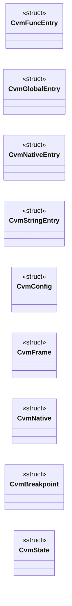

# `cvm2/cvm.h`

> Source: [cvm2/cvm.h:1](../../cvm2/cvm.h#L1) | language `h` | coverage 3.6% | [API index](../index.md)

## Contents

- **Structs:** [`CvmFuncEntry`](#cvmfuncentry), [`CvmGlobalEntry`](#cvmglobalentry), [`CvmNativeEntry`](#cvmnativeentry), [`CvmStringEntry`](#cvmstringentry), [`CvmConfig`](#cvmconfig), [`CvmFrame`](#cvmframe), [`CvmNative`](#cvmnative), [`CvmBreakpoint`](#cvmbreakpoint), [`CvmState`](#cvmstate)
- **Functions:** [`cvm_create`](#cvm_create), [`cvm_destroy`](#cvm_destroy), [`cvm_load_module`](#cvm_load_module), [`cvm_load_module_file`](#cvm_load_module_file), [`cvm_run`](#cvm_run), [`cvm_continue`](#cvm_continue), [`cvm_step`](#cvm_step), [`cvm_exit_code`](#cvm_exit_code), [`cvm_instruction_count`](#cvm_instruction_count), [`cvm_strerror`](#cvm_strerror), [`cvm_register_native`](#cvm_register_native), [`cvm_set_args`](#cvm_set_args), [`cvm_heap_alloc`](#cvm_heap_alloc), [`cvm_break_set`](#cvm_break_set), [`cvm_break_clear`](#cvm_break_clear), [`cvm_break_clear_all`](#cvm_break_clear_all), [`cvm_break_hit`](#cvm_break_hit), [`cvm_profile_begin`](#cvm_profile_begin), [`cvm_profile_end`](#cvm_profile_end)
- **Macros:** [`CVM_MAGIC_0`](#cvm_magic_0), [`CVM_MAGIC_1`](#cvm_magic_1), [`CVM_MAGIC_2`](#cvm_magic_2), [`CVM_MAGIC_3`](#cvm_magic_3), [`CVM_VERSION_MAJOR`](#cvm_version_major), [`CVM_VERSION_MINOR`](#cvm_version_minor), [`CVM_MODULE_HEADER_SIZE`](#cvm_module_header_size), [`CVM_FUNC_ENTRY_SIZE`](#cvm_func_entry_size), [`CVM_GLOBAL_ENTRY_SIZE`](#cvm_global_entry_size), [`CVM_NATIVE_ENTRY_SIZE`](#cvm_native_entry_size), [`CVM_STRING_ENTRY_SIZE`](#cvm_string_entry_size), [`CVM_MAX_NARGS`](#cvm_max_nargs), [`CVM_MAX_SARGS`](#cvm_max_sargs), [`CVM_SHIFT_MASK`](#cvm_shift_mask), [`CVM_SYS_READ`](#cvm_sys_read), [`CVM_SYS_WRITE`](#cvm_sys_write), [`CVM_SYS_EXIT`](#cvm_sys_exit), [`CVM_DATA_ARGC`](#cvm_data_argc), [`CVM_DATA_ARGV`](#cvm_data_argv), [`CVM_DATA_RSP`](#cvm_data_rsp), [`CVM_DATA_RBP`](#cvm_data_rbp), [`CVM_DATA_ARGS`](#cvm_data_args), [`CVM_DATA_RET`](#cvm_data_ret), [`CVM_DATA_STACK_SIZE`](#cvm_data_stack_size), [`CVM_DATA_STACK_BASE`](#cvm_data_stack_base), [`CVM_MAX_BREAKPOINTS`](#cvm_max_breakpoints)
- **Variables:** [`CvmOpcode`](#cvmopcode)

## Type Diagram



## Structs

<a id="cvmfuncentry"></a>

### `CvmFuncEntry`

`struct` | [cvm2/cvm.h:154](../../cvm2/cvm.h#L154)

```c
typedef struct
```

---

<a id="cvmglobalentry"></a>

### `CvmGlobalEntry`

`struct` | [cvm2/cvm.h:162](../../cvm2/cvm.h#L162)

```c
typedef struct
```

---

<a id="cvmnativeentry"></a>

### `CvmNativeEntry`

`struct` | [cvm2/cvm.h:167](../../cvm2/cvm.h#L167)

```c
typedef struct
```

---

<a id="cvmstringentry"></a>

### `CvmStringEntry`

`struct` | [cvm2/cvm.h:171](../../cvm2/cvm.h#L171)

```c
typedef struct
```

---

<a id="cvmconfig"></a>

### `CvmConfig`

`struct` | [cvm2/cvm.h:176](../../cvm2/cvm.h#L176)

```c
typedef struct
```

---

<a id="cvmframe"></a>

### `CvmFrame`

`struct` | [cvm2/cvm.h:189](../../cvm2/cvm.h#L189)

```c
typedef struct
```

---

<a id="cvmnative"></a>

### `CvmNative`

`struct` | [cvm2/cvm.h:198](../../cvm2/cvm.h#L198)

```c
typedef struct
```

---

<a id="cvmbreakpoint"></a>

### `CvmBreakpoint`

`struct` | [cvm2/cvm.h:205](../../cvm2/cvm.h#L205)

```c
typedef struct
```

---

<a id="cvmstate"></a>

### `CvmState`

`struct` | [cvm2/cvm.h:209](../../cvm2/cvm.h#L209)

```c
typedef struct
```

---

## Functions

<a id="cvm_create"></a>

### `cvm_create`

`function` | [cvm2/cvm.h:247](../../cvm2/cvm.h#L247)

```c
CvmState *cvm_create(const CvmConfig *config);
```

/* Heap (bump allocator for simplicity) uint8_t    *heap; size_t      heap_used; size_t      heap_size; /* Stats / debug uint64_t    instr_count; int         running; int         trace; } CVM; /* ------------------------------------------------------------------ /*  Public API /* ------------------------------------------------------------------

**Parameters**

| Name | Type | Default | Description |
|---|---|---|---|
| `config` | `CvmConfig *` |  |  |

**Returns:** `CvmState *`

> **Inherited:** Documentation from [`cvm_create`](#cvm_create) (cvm.h:215).

*Called by:* [`main`](cvm2.cvm_dbg_main.c.md#main), [`main`](cvm2.gen_fib_cvm.c.md#main), [`main`](cvm2.gen_minimal.c.md#main)

---

<a id="cvm_destroy"></a>

### `cvm_destroy`

`function` | [cvm2/cvm.h:248](../../cvm2/cvm.h#L248)

```c
void cvm_destroy(CvmState *vm);
```

**Parameters**

| Name | Type | Default | Description |
|---|---|---|---|
| `vm` | `CvmState *` |  |  |

*Called by:* [`main`](cvm2.cvm_dbg_main.c.md#main), [`main`](cvm2.gen_fib_cvm.c.md#main), [`main`](cvm2.gen_minimal.c.md#main)

---

<a id="cvm_load_module"></a>

### `cvm_load_module`

`function` | [cvm2/cvm.h:249](../../cvm2/cvm.h#L249)

```c
int cvm_load_module(CvmState *vm, const uint8_t *data, size_t size);
```

**Parameters**

| Name | Type | Default | Description |
|---|---|---|---|
| `vm` | `CvmState *` |  |  |
| `data` | `uint8_t *` |  |  |
| `size` | `size_t` |  |  |

**Returns:** `int`

*Called by:* [`main`](cvm2.cvm_dbg_main.c.md#main), [`main`](cvm2.gen_fib_cvm.c.md#main), [`main`](cvm2.gen_minimal.c.md#main)

---

<a id="cvm_load_module_file"></a>

### `cvm_load_module_file`

`function` | [cvm2/cvm.h:250](../../cvm2/cvm.h#L250)

```c
int cvm_load_module_file(CvmState *vm, const char *path);
```

**Parameters**

| Name | Type | Default | Description |
|---|---|---|---|
| `vm` | `CvmState *` |  |  |
| `path` | `char *` |  |  |

**Returns:** `int`

---

<a id="cvm_run"></a>

### `cvm_run`

`function` | [cvm2/cvm.h:251](../../cvm2/cvm.h#L251)

```c
int cvm_run(CvmState *vm);
```

**Parameters**

| Name | Type | Default | Description |
|---|---|---|---|
| `vm` | `CvmState *` |  |  |

**Returns:** `int`

*Called by:* [`main`](cvm2.gen_fib_cvm.c.md#main), [`main`](cvm2.gen_minimal.c.md#main)

---

<a id="cvm_continue"></a>

### `cvm_continue`

`function` | [cvm2/cvm.h:252](../../cvm2/cvm.h#L252)

```c
int cvm_continue(CvmState *vm);
```

**Parameters**

| Name | Type | Default | Description |
|---|---|---|---|
| `vm` | `CvmState *` |  |  |

**Returns:** `int`

---

<a id="cvm_step"></a>

### `cvm_step`

`function` | [cvm2/cvm.h:253](../../cvm2/cvm.h#L253)

```c
int cvm_step(CvmState *vm);
```

**Parameters**

| Name | Type | Default | Description |
|---|---|---|---|
| `vm` | `CvmState *` |  |  |

**Returns:** `int`

---

<a id="cvm_exit_code"></a>

### `cvm_exit_code`

`function` | [cvm2/cvm.h:254](../../cvm2/cvm.h#L254)

```c
int64_t cvm_exit_code(const CvmState *vm);
```

**Parameters**

| Name | Type | Default | Description |
|---|---|---|---|
| `vm` | `CvmState *` |  |  |

**Returns:** `int64_t`

*Called by:* [`main`](cvm2.cvm_dbg_main.c.md#main), [`main`](cvm2.gen_fib_cvm.c.md#main), [`main`](cvm2.gen_minimal.c.md#main)

---

<a id="cvm_instruction_count"></a>

### `cvm_instruction_count`

`function` | [cvm2/cvm.h:255](../../cvm2/cvm.h#L255)

```c
uint64_t cvm_instruction_count(const CvmState *vm);
```

**Parameters**

| Name | Type | Default | Description |
|---|---|---|---|
| `vm` | `CvmState *` |  |  |

**Returns:** `uint64_t`

*Called by:* [`main`](cvm2.gen_fib_cvm.c.md#main)

---

<a id="cvm_strerror"></a>

### `cvm_strerror`

`function` `const` | [cvm2/cvm.h:256](../../cvm2/cvm.h#L256)

```c
const char *cvm_strerror(int error_code);
```

**Parameters**

| Name | Type | Default | Description |
|---|---|---|---|
| `error_code` | `int` |  |  |

**Returns:** `char *`

*Called by:* [`main`](cvm2.cvm_dbg_main.c.md#main), [`main`](cvm2.gen_fib_cvm.c.md#main), [`main`](cvm2.gen_minimal.c.md#main)

---

<a id="cvm_register_native"></a>

### `cvm_register_native`

`function` | [cvm2/cvm.h:258](../../cvm2/cvm.h#L258)

```c
int cvm_register_native(CvmState *vm, const char *name, CvmNativeFn fn);
```

**Parameters**

| Name | Type | Default | Description |
|---|---|---|---|
| `vm` | `CvmState *` |  |  |
| `name` | `char *` |  |  |
| `fn` | `CvmNativeFn` |  |  |

**Returns:** `int`

---

<a id="cvm_set_args"></a>

### `cvm_set_args`

`function` | [cvm2/cvm.h:259](../../cvm2/cvm.h#L259)

```c
int cvm_set_args(CvmState *vm, int argc, char **argv);
```

**Parameters**

| Name | Type | Default | Description |
|---|---|---|---|
| `vm` | `CvmState *` |  |  |
| `argc` | `int` |  |  |
| `argv` | `char **` |  |  |

**Returns:** `int`

---

<a id="cvm_heap_alloc"></a>

### `cvm_heap_alloc`

`function` | [cvm2/cvm.h:260](../../cvm2/cvm.h#L260)

```c
void *cvm_heap_alloc(CvmState *vm, size_t size);
```

**Parameters**

| Name | Type | Default | Description |
|---|---|---|---|
| `vm` | `CvmState *` |  |  |
| `size` | `size_t` |  |  |

**Returns:** `void *`

---

<a id="cvm_break_set"></a>

### `cvm_break_set`

`function` | [cvm2/cvm.h:262](../../cvm2/cvm.h#L262)

```c
int cvm_break_set(CvmState *vm, size_t ip);
```

**Parameters**

| Name | Type | Default | Description |
|---|---|---|---|
| `vm` | `CvmState *` |  |  |
| `ip` | `size_t` |  |  |

**Returns:** `int`

---

<a id="cvm_break_clear"></a>

### `cvm_break_clear`

`function` | [cvm2/cvm.h:263](../../cvm2/cvm.h#L263)

```c
int cvm_break_clear(CvmState *vm, size_t ip);
```

**Parameters**

| Name | Type | Default | Description |
|---|---|---|---|
| `vm` | `CvmState *` |  |  |
| `ip` | `size_t` |  |  |

**Returns:** `int`

---

<a id="cvm_break_clear_all"></a>

### `cvm_break_clear_all`

`function` | [cvm2/cvm.h:264](../../cvm2/cvm.h#L264)

```c
void cvm_break_clear_all(CvmState *vm);
```

**Parameters**

| Name | Type | Default | Description |
|---|---|---|---|
| `vm` | `CvmState *` |  |  |

---

<a id="cvm_break_hit"></a>

### `cvm_break_hit`

`function` | [cvm2/cvm.h:265](../../cvm2/cvm.h#L265)

```c
int cvm_break_hit(const CvmState *vm);
```

**Parameters**

| Name | Type | Default | Description |
|---|---|---|---|
| `vm` | `CvmState *` |  |  |

**Returns:** `int`

---

<a id="cvm_profile_begin"></a>

### `cvm_profile_begin`

`function` | [cvm2/cvm.h:266](../../cvm2/cvm.h#L266)

```c
int cvm_profile_begin(CvmState *vm);
```

**Parameters**

| Name | Type | Default | Description |
|---|---|---|---|
| `vm` | `CvmState *` |  |  |

**Returns:** `int`

---

<a id="cvm_profile_end"></a>

### `cvm_profile_end`

`function` | [cvm2/cvm.h:267](../../cvm2/cvm.h#L267)

```c
void cvm_profile_end(CvmState *vm);
```

**Parameters**

| Name | Type | Default | Description |
|---|---|---|---|
| `vm` | `CvmState *` |  |  |

---

## Macros

<a id="cvm_magic_0"></a>

### `CVM_MAGIC_0`

`macro` | [cvm2/cvm.h:41](../../cvm2/cvm.h#L41)

```c
#define CVM_MAGIC_0
```

---

<a id="cvm_magic_1"></a>

### `CVM_MAGIC_1`

`macro` | [cvm2/cvm.h:42](../../cvm2/cvm.h#L42)

```c
#define CVM_MAGIC_1
```

---

<a id="cvm_magic_2"></a>

### `CVM_MAGIC_2`

`macro` | [cvm2/cvm.h:43](../../cvm2/cvm.h#L43)

```c
#define CVM_MAGIC_2
```

---

<a id="cvm_magic_3"></a>

### `CVM_MAGIC_3`

`macro` | [cvm2/cvm.h:44](../../cvm2/cvm.h#L44)

```c
#define CVM_MAGIC_3
```

---

<a id="cvm_version_major"></a>

### `CVM_VERSION_MAJOR`

`macro` | [cvm2/cvm.h:45](../../cvm2/cvm.h#L45)

```c
#define CVM_VERSION_MAJOR
```

---

<a id="cvm_version_minor"></a>

### `CVM_VERSION_MINOR`

`macro` | [cvm2/cvm.h:46](../../cvm2/cvm.h#L46)

```c
#define CVM_VERSION_MINOR
```

---

<a id="cvm_module_header_size"></a>

### `CVM_MODULE_HEADER_SIZE`

`macro` | [cvm2/cvm.h:47](../../cvm2/cvm.h#L47)

```c
#define CVM_MODULE_HEADER_SIZE
```

---

<a id="cvm_func_entry_size"></a>

### `CVM_FUNC_ENTRY_SIZE`

`macro` | [cvm2/cvm.h:48](../../cvm2/cvm.h#L48)

```c
#define CVM_FUNC_ENTRY_SIZE
```

---

<a id="cvm_global_entry_size"></a>

### `CVM_GLOBAL_ENTRY_SIZE`

`macro` | [cvm2/cvm.h:49](../../cvm2/cvm.h#L49)

```c
#define CVM_GLOBAL_ENTRY_SIZE
```

---

<a id="cvm_native_entry_size"></a>

### `CVM_NATIVE_ENTRY_SIZE`

`macro` | [cvm2/cvm.h:50](../../cvm2/cvm.h#L50)

```c
#define CVM_NATIVE_ENTRY_SIZE
```

---

<a id="cvm_string_entry_size"></a>

### `CVM_STRING_ENTRY_SIZE`

`macro` | [cvm2/cvm.h:51](../../cvm2/cvm.h#L51)

```c
#define CVM_STRING_ENTRY_SIZE
```

---

<a id="cvm_max_nargs"></a>

### `CVM_MAX_NARGS`

`macro` | [cvm2/cvm.h:53](../../cvm2/cvm.h#L53)

```c
#define CVM_MAX_NARGS
```

---

<a id="cvm_max_sargs"></a>

### `CVM_MAX_SARGS`

`macro` | [cvm2/cvm.h:54](../../cvm2/cvm.h#L54)

```c
#define CVM_MAX_SARGS
```

---

<a id="cvm_shift_mask"></a>

### `CVM_SHIFT_MASK`

`macro` | [cvm2/cvm.h:55](../../cvm2/cvm.h#L55)

```c
#define CVM_SHIFT_MASK
```

---

<a id="cvm_sys_read"></a>

### `CVM_SYS_READ`

`macro` | [cvm2/cvm.h:56](../../cvm2/cvm.h#L56)

```c
#define CVM_SYS_READ
```

---

<a id="cvm_sys_write"></a>

### `CVM_SYS_WRITE`

`macro` | [cvm2/cvm.h:57](../../cvm2/cvm.h#L57)

```c
#define CVM_SYS_WRITE
```

---

<a id="cvm_sys_exit"></a>

### `CVM_SYS_EXIT`

`macro` | [cvm2/cvm.h:58](../../cvm2/cvm.h#L58)

```c
#define CVM_SYS_EXIT
```

---

<a id="cvm_data_argc"></a>

### `CVM_DATA_ARGC`

`macro` | [cvm2/cvm.h:60](../../cvm2/cvm.h#L60)

```c
#define CVM_DATA_ARGC
```

---

<a id="cvm_data_argv"></a>

### `CVM_DATA_ARGV`

`macro` | [cvm2/cvm.h:61](../../cvm2/cvm.h#L61)

```c
#define CVM_DATA_ARGV
```

---

<a id="cvm_data_rsp"></a>

### `CVM_DATA_RSP`

`macro` | [cvm2/cvm.h:62](../../cvm2/cvm.h#L62)

```c
#define CVM_DATA_RSP
```

---

<a id="cvm_data_rbp"></a>

### `CVM_DATA_RBP`

`macro` | [cvm2/cvm.h:63](../../cvm2/cvm.h#L63)

```c
#define CVM_DATA_RBP
```

---

<a id="cvm_data_args"></a>

### `CVM_DATA_ARGS`

`macro` | [cvm2/cvm.h:64](../../cvm2/cvm.h#L64)

```c
#define CVM_DATA_ARGS
```

---

<a id="cvm_data_ret"></a>

### `CVM_DATA_RET`

`macro` | [cvm2/cvm.h:65](../../cvm2/cvm.h#L65)

```c
#define CVM_DATA_RET
```

---

<a id="cvm_data_stack_size"></a>

### `CVM_DATA_STACK_SIZE`

`macro` | [cvm2/cvm.h:66](../../cvm2/cvm.h#L66)

```c
#define CVM_DATA_STACK_SIZE
```

---

<a id="cvm_data_stack_base"></a>

### `CVM_DATA_STACK_BASE`

`macro` | [cvm2/cvm.h:70](../../cvm2/cvm.h#L70)

```c
#define CVM_DATA_STACK_BASE
```

Offset of the stored stack-region base: the value written here tells the interpreter where the x86 stack region begins inside the data section.

Old modules keep it zero and the interpreter falls back to offset 96.

---

<a id="cvm_max_breakpoints"></a>

### `CVM_MAX_BREAKPOINTS`

`macro` | [cvm2/cvm.h:203](../../cvm2/cvm.h#L203)

```c
#define CVM_MAX_BREAKPOINTS
```

---

## Variables

<a id="cvmopcode"></a>

### `CvmOpcode`

`variable` `extern` | [cvm2/cvm.h:38](../../cvm2/cvm.h#L38)

```c
extern "C" { #endif #define CVM_MAGIC_0 0x43 #define CVM_MAGIC_1 0x56 #define CVM_MAGIC_2 0x4D #define CVM_MAGIC_3 0x04 #define CVM_VERSION_MAJOR 1 #define CVM_VERSION_MINOR 0 #define CVM_MODULE_HEADE
```

ifdef __cplusplus

---
