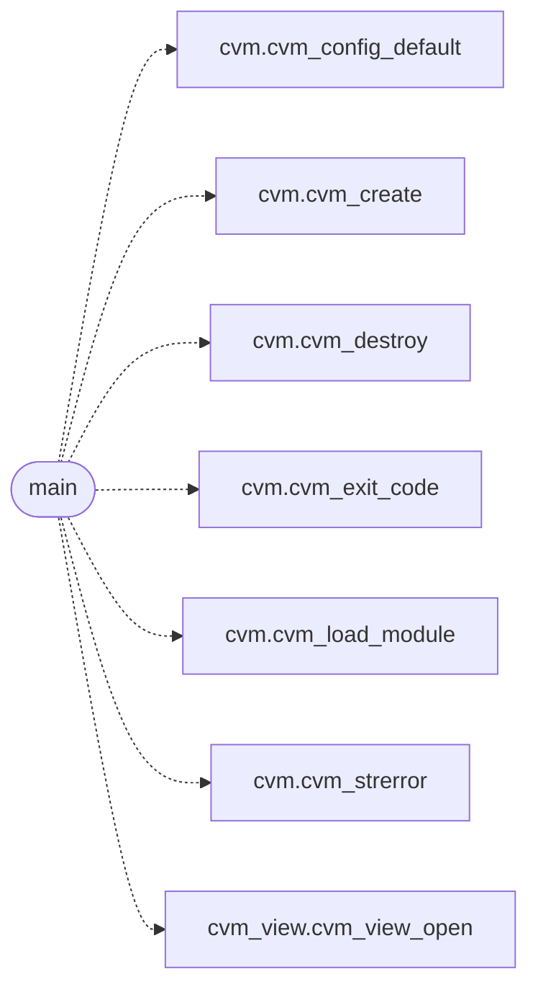

# `cvm2/cvm_dbg_main.c`

> Source: [cvm2/cvm_dbg_main.c:1](../../cvm2/cvm_dbg_main.c#L1) | language `c` | coverage 0.0% | [API index](../index.md)

## Contents

- **Functions:** [`main`](#main)
- **Macros:** [`DBG_LINE_MAX`](#dbg_line_max), [`DBG_PROFILE_TOP`](#dbg_profile_top)

## Call Graph

Solid arrows stay in this module, dashed arrows leave it.



## Functions

<a id="main"></a>

### `main`

`function` | [cvm2/cvm_dbg_main.c:337](../../cvm2/cvm_dbg_main.c#L337)

```c
int main(int argc, char **argv)
```

**Parameters**

| Name | Type | Default | Description |
|---|---|---|---|
| `argc` | `int` |  |  |
| `argv` | `char **` |  |  |

**Returns:** `int`

*Calls:* [`cvm_config_default`](cvm2.cvm.c.md#cvm_config_default), [`cvm_create`](cvm2.cvm.h.md#cvm_create), [`cvm_destroy`](cvm2.cvm.h.md#cvm_destroy), [`cvm_exit_code`](cvm2.cvm.h.md#cvm_exit_code), [`cvm_load_module`](cvm2.cvm.h.md#cvm_load_module), [`cvm_strerror`](cvm2.cvm.h.md#cvm_strerror), [`cvm_view_open`](cvm2.cvm_view.h.md#cvm_view_open)

---

## Macros

<a id="dbg_line_max"></a>

### `DBG_LINE_MAX`

`macro` | [cvm2/cvm_dbg_main.c:18](../../cvm2/cvm_dbg_main.c#L18)

```c
#define DBG_LINE_MAX
```

---

<a id="dbg_profile_top"></a>

### `DBG_PROFILE_TOP`

`macro` | [cvm2/cvm_dbg_main.c:19](../../cvm2/cvm_dbg_main.c#L19)

```c
#define DBG_PROFILE_TOP
```

---
