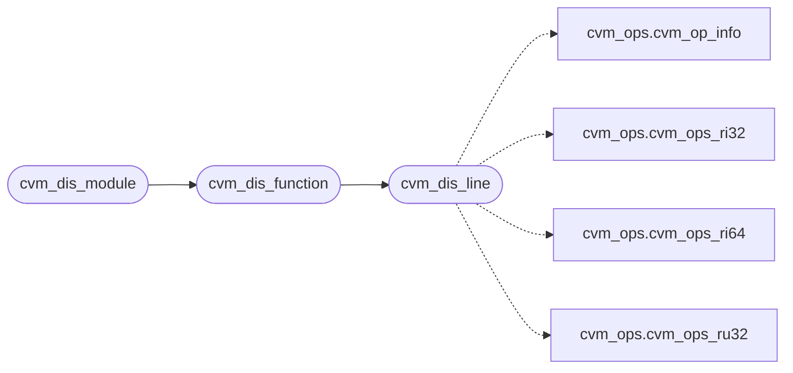

# `cvm2/cvm_dis.c`

> Source: [cvm2/cvm_dis.c:1](../../cvm2/cvm_dis.c#L1) | language `c` | coverage 60.0% | [API index](../index.md)

## Contents

- **Functions:** [`cvm_dis_line`](#cvm_dis_line), [`cvm_dis_function`](#cvm_dis_function), [`cvm_dis_module`](#cvm_dis_module)
- **Macros:** [`CVM_DIS_LINE_MAX`](#cvm_dis_line_max)

## Call Graph

Solid arrows stay in this module, dashed arrows leave it.



## Functions

<a id="cvm_dis_line"></a>

### `cvm_dis_line`

`function` | [cvm2/cvm_dis.c:56](../../cvm2/cvm_dis.c#L56)

```c
int cvm_dis_line(const CvmModuleView *v, size_t off, size_t end, char *buf, size_t cap)
```

One instruction at code offset off (within [begin,end)).

Returns the instruction size, or -1 when it does not decode inside the region.

**Parameters**

| Name | Type | Default | Description |
|---|---|---|---|
| `v` | `CvmModuleView *` |  |  |
| `off` | `size_t` |  |  |
| `end` | `size_t` |  |  |
| `buf` | `char *` |  |  |
| `cap` | `size_t` |  |  |

**Returns:** `int`

> **Inherited:** Documentation from [`cvm_dis_line`](#cvm_dis_line) (cvm2/cvm_dis.h:31).

*Calls:* [`cvm_op_info`](cvm2.cvm_ops.h.md#cvm_op_info), [`cvm_ops_ri32`](cvm2.cvm_ops.h.md#cvm_ops_ri32), [`cvm_ops_ri64`](cvm2.cvm_ops.h.md#cvm_ops_ri64), [`cvm_ops_ru32`](cvm2.cvm_ops.h.md#cvm_ops_ru32)

*Called by:* [`cvm_dis_function`](#cvm_dis_function)

---

<a id="cvm_dis_function"></a>

### `cvm_dis_function`

`function` | [cvm2/cvm_dis.c:153](../../cvm2/cvm_dis.c#L153)

```c
int cvm_dis_function(const CvmModuleView *v, size_t begin, size_t end, CvmDisEmit emit, void *ctx)
```

One function region from begin up to end.

**Parameters**

| Name | Type | Default | Description |
|---|---|---|---|
| `v` | `CvmModuleView *` |  |  |
| `begin` | `size_t` |  |  |
| `end` | `size_t` |  |  |
| `emit` | `CvmDisEmit` |  |  |
| `ctx` | `void *` |  |  |

**Returns:** `int`

> **Inherited:** Documentation from [`cvm_dis_function`](#cvm_dis_function) (cvm2/cvm_dis.h:26).

*Calls:* [`cvm_dis_line`](#cvm_dis_line)

*Called by:* [`cvm_dis_module`](#cvm_dis_module)

---

<a id="cvm_dis_module"></a>

### `cvm_dis_module`

`function` | [cvm2/cvm_dis.c:173](../../cvm2/cvm_dis.c#L173)

```c
int cvm_dis_module(const CvmModuleView *v, CvmDisEmit emit, void *ctx)
```

Whole module: header summary plus every function region.

**Parameters**

| Name | Type | Default | Description |
|---|---|---|---|
| `v` | `CvmModuleView *` |  |  |
| `emit` | `CvmDisEmit` |  |  |
| `ctx` | `void *` |  |  |

**Returns:** `int`

> **Inherited:** Documentation from [`cvm_dis_module`](#cvm_dis_module) (cvm2/cvm_dis.h:23).

*Calls:* [`cvm_dis_function`](#cvm_dis_function)

---

## Macros

<a id="cvm_dis_line_max"></a>

### `CVM_DIS_LINE_MAX`

`macro` | [cvm2/cvm_dis.c:11](../../cvm2/cvm_dis.c#L11)

```c
#define CVM_DIS_LINE_MAX
```

---
