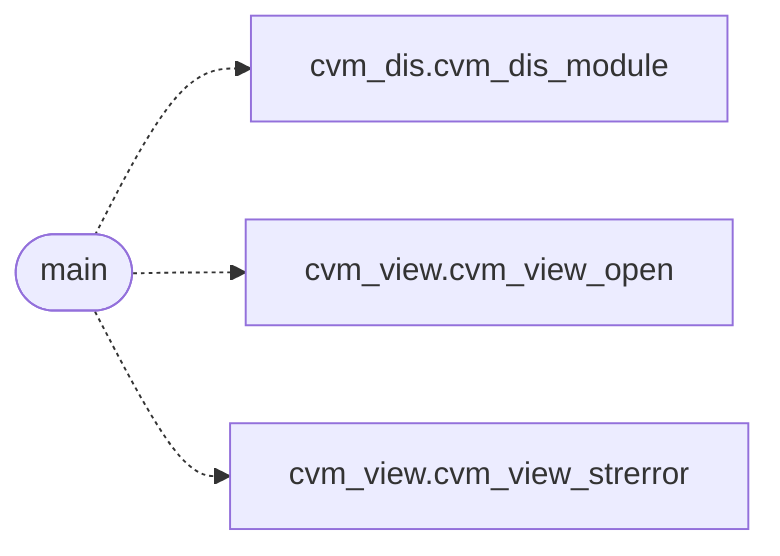

# `cvm2/cvm_dis_main.c`

> Source: [cvm2/cvm_dis_main.c:1](../../cvm2/cvm_dis_main.c#L1) | language `c` | coverage 0.0% | [API index](../index.md)

## Contents

- **Functions:** [`main`](#main)

## Call Graph

Solid arrows stay in this module, dashed arrows leave it.



## Functions

<a id="main"></a>

### `main`

`function` | [cvm2/cvm_dis_main.c:18](../../cvm2/cvm_dis_main.c#L18)

```c
int main(int argc, char **argv)
```

**Parameters**

| Name | Type | Default | Description |
|---|---|---|---|
| `argc` | `int` |  |  |
| `argv` | `char **` |  |  |

**Returns:** `int`

*Calls:* [`cvm_dis_module`](cvm2.cvm_dis.h.md#cvm_dis_module), [`cvm_view_open`](cvm2.cvm_view.h.md#cvm_view_open), [`cvm_view_strerror`](cvm2.cvm_view.h.md#cvm_view_strerror)

---
