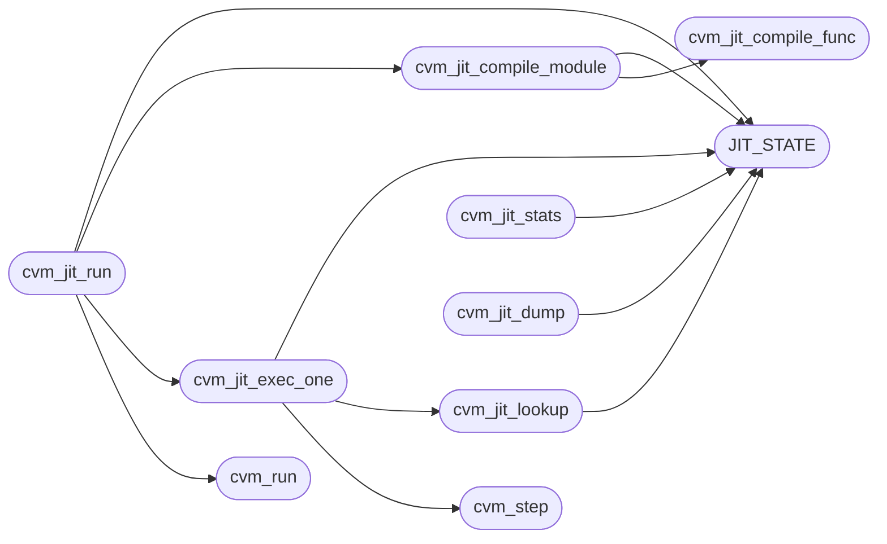

# `cvm2/cvm_jit.c`

> Source: [cvm2/cvm_jit.c:1](../../cvm2/cvm_jit.c#L1) | language `c` | coverage 61.1% | [API index](../index.md)

## Contents

- **Structs:** [`JitCtx`](#jitctx)
- **Functions:** [`cvm_jit_create`](#cvm_jit_create), [`cvm_jit_destroy`](#cvm_jit_destroy), [`error`](#error), [`cvm_jit_compile_func`](#cvm_jit_compile_func), [`cvm_jit_compile_module`](#cvm_jit_compile_module), [`cvm_jit_lookup`](#cvm_jit_lookup), [`cvm_jit_exec_one`](#cvm_jit_exec_one), [`cvm_step`](#cvm_step), [`cvm_jit_run`](#cvm_jit_run), [`cvm_run`](#cvm_run), [`cvm_jit_stats`](#cvm_jit_stats), [`cvm_jit_dump`](#cvm_jit_dump)
- **Macros:** [`JIT_STATE`](#jit_state), [`EMIT_CMP`](#emit_cmp), [`EMIT_CMP_SIGNED`](#emit_cmp_signed), [`EMIT_CMP_UNSIGNED`](#emit_cmp_unsigned)

## Call Graph

Solid arrows stay in this module, dashed arrows leave it.



## Structs

<a id="jitctx"></a>

### `JitCtx`

`struct` | [cvm2/cvm_jit.c:288](../../cvm2/cvm_jit.c#L288)

```c
typedef struct
```

---

## Functions

<a id="cvm_jit_create"></a>

### `cvm_jit_create`

`function` | [cvm2/cvm_jit.c:36](../../cvm2/cvm_jit.c#L36)

```c
CvmJitState *cvm_jit_create(void)
```

Create JIT state.

Call after cvm_create().

**Returns:** `CvmJitState *`

> **Inherited:** Documentation from [`cvm_jit_create`](#cvm_jit_create) (cvm2/cvm_jit.h:120).

---

<a id="cvm_jit_destroy"></a>

### `cvm_jit_destroy`

`function` | [cvm2/cvm_jit.c:48](../../cvm2/cvm_jit.c#L48)

```c
void cvm_jit_destroy(CvmJitState *jit)
```

Destroy JIT state.

Call before cvm_destroy().

**Parameters**

| Name | Type | Default | Description |
|---|---|---|---|
| `jit` | `CvmJitState *` |  |  |

> **Inherited:** Documentation from [`cvm_jit_destroy`](#cvm_jit_destroy) (cvm2/cvm_jit.h:123).

---

<a id="error"></a>

### `error`

`function` | [cvm2/cvm_jit.c:267](../../cvm2/cvm_jit.c#L267)

```c
* keeps executing dead code after the stop: error() -> exit() returns * into the middle of the f...
```

**Returns:** `exit() returns * into the middle of the f...`

---

<a id="cvm_jit_compile_func"></a>

### `cvm_jit_compile_func`

`function` | [cvm2/cvm_jit.c:1253](../../cvm2/cvm_jit.c#L1253)

```c
void *cvm_jit_compile_func(CvmState *vm, uint32_t func_idx)
```

Compile a single function.

Returns pointer to native code, or NULL.

**Parameters**

| Name | Type | Default | Description |
|---|---|---|---|
| `vm` | `CvmState *` |  |  |
| `func_idx` | `uint32_t` |  |  |

**Returns:** `void *`

> **Inherited:** Documentation from [`cvm_jit_compile_func`](#cvm_jit_compile_func) (cvm2/cvm_jit.h:130).

*Called by:* [`cvm_jit_compile_module`](#cvm_jit_compile_module)

---

<a id="cvm_jit_compile_module"></a>

### `cvm_jit_compile_module`

`function` | [cvm2/cvm_jit.c:1360](../../cvm2/cvm_jit.c#L1360)

```c
int cvm_jit_compile_module(CvmState *vm)
```

Compile all functions in a loaded module to native code.

Returns CVM_OK on success.

**Parameters**

| Name | Type | Default | Description |
|---|---|---|---|
| `vm` | `CvmState *` |  |  |

**Returns:** `int`

> **Inherited:** Documentation from [`cvm_jit_compile_module`](#cvm_jit_compile_module) (cvm2/cvm_jit.h:127).

*Calls:* [`JIT_STATE`](#jit_state), [`cvm_jit_compile_func`](#cvm_jit_compile_func)

*Called by:* [`cvm_jit_run`](#cvm_jit_run)

---

<a id="cvm_jit_lookup"></a>

### `cvm_jit_lookup`

`function` | [cvm2/cvm_jit.c:1376](../../cvm2/cvm_jit.c#L1376)

```c
void *cvm_jit_lookup(CvmState *vm, uint32_t func_idx)
```

Look up native code for a function.

Returns pointer or NULL.

**Parameters**

| Name | Type | Default | Description |
|---|---|---|---|
| `vm` | `CvmState *` |  |  |
| `func_idx` | `uint32_t` |  |  |

**Returns:** `void *`

> **Inherited:** Documentation from [`cvm_jit_lookup`](#cvm_jit_lookup) (cvm2/cvm_jit.h:133).

*Calls:* [`JIT_STATE`](#jit_state)

*Called by:* [`cvm_jit_exec_one`](#cvm_jit_exec_one)

---

<a id="cvm_jit_exec_one"></a>

### `cvm_jit_exec_one`

`function` | [cvm2/cvm_jit.c:1397](../../cvm2/cvm_jit.c#L1397)

```c
void cvm_jit_exec_one(CvmState *vm)
```

**Parameters**

| Name | Type | Default | Description |
|---|---|---|---|
| `vm` | `CvmState *` |  |  |

*Calls:* [`JIT_STATE`](#jit_state), [`cvm_jit_lookup`](#cvm_jit_lookup), [`cvm_step`](#cvm_step)

*Called by:* [`cvm_jit_run`](#cvm_jit_run)

---

<a id="cvm_step"></a>

### `cvm_step`

`function` `extern` | [cvm2/cvm_jit.c:1420](../../cvm2/cvm_jit.c#L1420)

```c
extern int cvm_step(CvmState *);
```

Execute one instruction via the step function

**Parameters**

| Name | Type | Default | Description |
|---|---|---|---|
| `CvmState` |  |  |  |

**Returns:** `int`

*Called by:* [`cvm_jit_exec_one`](#cvm_jit_exec_one)

---

<a id="cvm_jit_run"></a>

### `cvm_jit_run`

`function` | [cvm2/cvm_jit.c:1427](../../cvm2/cvm_jit.c#L1427)

```c
int cvm_jit_run(CvmState *vm)
```

Execute using the JIT.

Compiles all functions first, then dispatches to compiled code.  Falls back to interpreter for uncompiled functions. Returns CVM_OK on success.

**Parameters**

| Name | Type | Default | Description |
|---|---|---|---|
| `vm` | `CvmState *` |  |  |

**Returns:** `int`

> **Inherited:** Documentation from [`cvm_jit_run`](#cvm_jit_run) (cvm2/cvm_jit.h:142).

*Calls:* [`JIT_STATE`](#jit_state), [`cvm_jit_compile_module`](#cvm_jit_compile_module), [`cvm_jit_exec_one`](#cvm_jit_exec_one), [`cvm_run`](#cvm_run)

---

<a id="cvm_run"></a>

### `cvm_run`

`function` `extern` | [cvm2/cvm_jit.c:1430](../../cvm2/cvm_jit.c#L1430)

```c
extern int cvm_run(CvmState *);
```

Should not be called without JIT; fall back to interpreter

**Parameters**

| Name | Type | Default | Description |
|---|---|---|---|
| `CvmState` |  |  |  |

**Returns:** `int`

*Called by:* [`cvm_jit_run`](#cvm_jit_run)

---

<a id="cvm_jit_stats"></a>

### `cvm_jit_stats`

`function` | [cvm2/cvm_jit.c:1488](../../cvm2/cvm_jit.c#L1488)

```c
void cvm_jit_stats(const CvmState *vm)
```

Print JIT compilation statistics to stderr.

**Parameters**

| Name | Type | Default | Description |
|---|---|---|---|
| `vm` | `CvmState *` |  |  |

> **Inherited:** Documentation from [`cvm_jit_stats`](#cvm_jit_stats) (cvm2/cvm_jit.h:153).

*Calls:* [`JIT_STATE`](#jit_state)

---

<a id="cvm_jit_dump"></a>

### `cvm_jit_dump`

`function` | [cvm2/cvm_jit.c:1499](../../cvm2/cvm_jit.c#L1499)

```c
void cvm_jit_dump(const CvmState *vm)
```

CVM_JIT_H

**Parameters**

| Name | Type | Default | Description |
|---|---|---|---|
| `vm` | `CvmState *` |  |  |

> **Inherited:** Documentation from [`cvm_jit_dump`](#cvm_jit_dump) (cvm2/cvm_jit.h:159).

*Calls:* [`JIT_STATE`](#jit_state)

---

## Macros

<a id="jit_state"></a>

### `JIT_STATE`

`macro` | [cvm2/cvm_jit.c:30](../../cvm2/cvm_jit.c#L30)

```c
#define JIT_STATE(vm)
```

vm->jit is void* in cvm.h; cast to the concrete type here

*Called by:* [`cvm_jit_compile_module`](#cvm_jit_compile_module), [`cvm_jit_dump`](#cvm_jit_dump), [`cvm_jit_exec_one`](#cvm_jit_exec_one), [`cvm_jit_lookup`](#cvm_jit_lookup), [`cvm_jit_run`](#cvm_jit_run), [`cvm_jit_stats`](#cvm_jit_stats)

---

<a id="emit_cmp"></a>

### `EMIT_CMP`

`macro` | [cvm2/cvm_jit.c:603](../../cvm2/cvm_jit.c#L603)

```c
#define EMIT_CMP(cc_signed)
```

---

<a id="emit_cmp_signed"></a>

### `EMIT_CMP_SIGNED`

`macro` | [cvm2/cvm_jit.c:624](../../cvm2/cvm_jit.c#L624)

```c
#define EMIT_CMP_SIGNED(cc)
```

---

<a id="emit_cmp_unsigned"></a>

### `EMIT_CMP_UNSIGNED`

`macro` | [cvm2/cvm_jit.c:636](../../cvm2/cvm_jit.c#L636)

```c
#define EMIT_CMP_UNSIGNED(cc)
```

---
