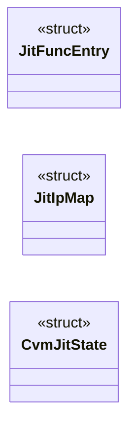

# `cvm2/cvm_jit.h`

> Source: [cvm2/cvm_jit.h:1](../../cvm2/cvm_jit.h#L1) | language `h` | coverage 36.0% | [API index](../index.md)

## Contents

- **Structs:** [`JitFuncEntry`](#jitfuncentry), [`JitIpMap`](#jitipmap), [`CvmJitState`](#cvmjitstate)
- **Functions:** [`cvm_jit_create`](#cvm_jit_create), [`cvm_jit_destroy`](#cvm_jit_destroy), [`cvm_jit_compile_module`](#cvm_jit_compile_module), [`cvm_jit_compile_func`](#cvm_jit_compile_func), [`cvm_jit_lookup`](#cvm_jit_lookup), [`cvm_jit_run`](#cvm_jit_run), [`returns`](#returns), [`cvm_jit_stats`](#cvm_jit_stats), [`cvm_jit_dump`](#cvm_jit_dump)
- **Macros:** [`JIT_REG_VM`](#jit_reg_vm), [`JIT_REG_SLOTS`](#jit_reg_slots), [`JIT_REG_SP`](#jit_reg_sp), [`JIT_REG_FRAMES`](#jit_reg_frames), [`JIT_REG_FRAME`](#jit_reg_frame), [`JIT_SCRATCH1`](#jit_scratch1), [`JIT_SCRATCH2`](#jit_scratch2), [`JIT_SCRATCH3`](#jit_scratch3), [`JIT_SCRATCH4`](#jit_scratch4), [`JIT_SCRATCH5`](#jit_scratch5), [`JIT_MAX_FUNCS`](#jit_max_funcs), [`JIT_IP_MAP_SIZE`](#jit_ip_map_size)
- **Variables:** [`JitTier`](#jittier)

## Type Diagram



## Structs

<a id="jitfuncentry"></a>

### `JitFuncEntry`

`struct` | [cvm2/cvm_jit.h:72](../../cvm2/cvm_jit.h#L72)

```c
typedef struct
```

---

<a id="jitipmap"></a>

### `JitIpMap`

`struct` | [cvm2/cvm_jit.h:84](../../cvm2/cvm_jit.h#L84)

```c
typedef struct
```

---

<a id="cvmjitstate"></a>

### `CvmJitState`

`struct` | [cvm2/cvm_jit.h:96](../../cvm2/cvm_jit.h#L96)

```c
typedef struct
```

---

## Functions

<a id="cvm_jit_create"></a>

### `cvm_jit_create`

`function` | [cvm2/cvm_jit.h:120](../../cvm2/cvm_jit.h#L120)

```c
CvmJitState *cvm_jit_create(void);
```

Create JIT state.

Call after cvm_create().

**Returns:** `CvmJitState *`

*Called by:* [`main`](cvm2.cvm.c.md#main), [`main`](cvm2.gen_fib_cvm.c.md#main)

---

<a id="cvm_jit_destroy"></a>

### `cvm_jit_destroy`

`function` | [cvm2/cvm_jit.h:123](../../cvm2/cvm_jit.h#L123)

```c
void cvm_jit_destroy(CvmJitState *jit);
```

Destroy JIT state.

Call before cvm_destroy().

**Parameters**

| Name | Type | Default | Description |
|---|---|---|---|
| `jit` | `CvmJitState *` |  |  |

*Called by:* [`cvm_destroy`](cvm2.cvm.c.md#cvm_destroy)

---

<a id="cvm_jit_compile_module"></a>

### `cvm_jit_compile_module`

`function` | [cvm2/cvm_jit.h:127](../../cvm2/cvm_jit.h#L127)

```c
int cvm_jit_compile_module(CvmState *vm);
```

Compile all functions in a loaded module to native code.

Returns CVM_OK on success.

**Parameters**

| Name | Type | Default | Description |
|---|---|---|---|
| `vm` | `CvmState *` |  |  |

**Returns:** `int`

---

<a id="cvm_jit_compile_func"></a>

### `cvm_jit_compile_func`

`function` | [cvm2/cvm_jit.h:130](../../cvm2/cvm_jit.h#L130)

```c
void *cvm_jit_compile_func(CvmState *vm, uint32_t func_idx);
```

Compile a single function.

Returns pointer to native code, or NULL.

**Parameters**

| Name | Type | Default | Description |
|---|---|---|---|
| `vm` | `CvmState *` |  |  |
| `func_idx` | `uint32_t` |  |  |

**Returns:** `void *`

---

<a id="cvm_jit_lookup"></a>

### `cvm_jit_lookup`

`function` | [cvm2/cvm_jit.h:133](../../cvm2/cvm_jit.h#L133)

```c
void *cvm_jit_lookup(CvmState *vm, uint32_t func_idx);
```

Look up native code for a function.

Returns pointer or NULL.

**Parameters**

| Name | Type | Default | Description |
|---|---|---|---|
| `vm` | `CvmState *` |  |  |
| `func_idx` | `uint32_t` |  |  |

**Returns:** `void *`

---

<a id="cvm_jit_run"></a>

### `cvm_jit_run`

`function` | [cvm2/cvm_jit.h:142](../../cvm2/cvm_jit.h#L142)

```c
int cvm_jit_run(CvmState *vm);
```

Execute using the JIT.

Compiles all functions first, then dispatches to compiled code.  Falls back to interpreter for uncompiled functions. Returns CVM_OK on success.

**Parameters**

| Name | Type | Default | Description |
|---|---|---|---|
| `vm` | `CvmState *` |  |  |

**Returns:** `int`

*Called by:* [`main`](cvm2.cvm.c.md#main), [`main`](cvm2.gen_fib_cvm.c.md#main)

---

<a id="returns"></a>

### `returns`

`function` | [cvm2/cvm_jit.h:145](../../cvm2/cvm_jit.h#L145)

```c
* returns (via RET) or encounters an error. */ void cvm_jit_exec_one(CvmState *vm);
```

**Parameters**

| Name | Type | Default | Description |
|---|---|---|---|
| `RET` | `via` |  |  |

**Returns:** `*`

---

<a id="cvm_jit_stats"></a>

### `cvm_jit_stats`

`function` | [cvm2/cvm_jit.h:153](../../cvm2/cvm_jit.h#L153)

```c
void cvm_jit_stats(const CvmState *vm);
```

Print JIT compilation statistics to stderr.

**Parameters**

| Name | Type | Default | Description |
|---|---|---|---|
| `vm` | `CvmState *` |  |  |

*Called by:* [`main`](cvm2.cvm.c.md#main)

---

<a id="cvm_jit_dump"></a>

### `cvm_jit_dump`

`function` | [cvm2/cvm_jit.h:159](../../cvm2/cvm_jit.h#L159)

```c
void cvm_jit_dump(const CvmState *vm);
```

CVM_JIT_H

**Parameters**

| Name | Type | Default | Description |
|---|---|---|---|
| `vm` | `CvmState *` |  |  |

---

## Macros

<a id="jit_reg_vm"></a>

### `JIT_REG_VM`

`macro` | [cvm2/cvm_jit.h:45](../../cvm2/cvm_jit.h#L45)

```c
#define JIT_REG_VM
```

---

<a id="jit_reg_slots"></a>

### `JIT_REG_SLOTS`

`macro` | [cvm2/cvm_jit.h:46](../../cvm2/cvm_jit.h#L46)

```c
#define JIT_REG_SLOTS
```

---

<a id="jit_reg_sp"></a>

### `JIT_REG_SP`

`macro` | [cvm2/cvm_jit.h:47](../../cvm2/cvm_jit.h#L47)

```c
#define JIT_REG_SP
```

---

<a id="jit_reg_frames"></a>

### `JIT_REG_FRAMES`

`macro` | [cvm2/cvm_jit.h:48](../../cvm2/cvm_jit.h#L48)

```c
#define JIT_REG_FRAMES
```

---

<a id="jit_reg_frame"></a>

### `JIT_REG_FRAME`

`macro` | [cvm2/cvm_jit.h:49](../../cvm2/cvm_jit.h#L49)

```c
#define JIT_REG_FRAME
```

---

<a id="jit_scratch1"></a>

### `JIT_SCRATCH1`

`macro` | [cvm2/cvm_jit.h:52](../../cvm2/cvm_jit.h#L52)

```c
#define JIT_SCRATCH1
```

Scratch registers for code generation

---

<a id="jit_scratch2"></a>

### `JIT_SCRATCH2`

`macro` | [cvm2/cvm_jit.h:53](../../cvm2/cvm_jit.h#L53)

```c
#define JIT_SCRATCH2
```

---

<a id="jit_scratch3"></a>

### `JIT_SCRATCH3`

`macro` | [cvm2/cvm_jit.h:54](../../cvm2/cvm_jit.h#L54)

```c
#define JIT_SCRATCH3
```

---

<a id="jit_scratch4"></a>

### `JIT_SCRATCH4`

`macro` | [cvm2/cvm_jit.h:55](../../cvm2/cvm_jit.h#L55)

```c
#define JIT_SCRATCH4
```

---

<a id="jit_scratch5"></a>

### `JIT_SCRATCH5`

`macro` | [cvm2/cvm_jit.h:56](../../cvm2/cvm_jit.h#L56)

```c
#define JIT_SCRATCH5
```

---

<a id="jit_max_funcs"></a>

### `JIT_MAX_FUNCS`

`macro` | [cvm2/cvm_jit.h:93](../../cvm2/cvm_jit.h#L93)

```c
#define JIT_MAX_FUNCS
```

---

<a id="jit_ip_map_size"></a>

### `JIT_IP_MAP_SIZE`

`macro` | [cvm2/cvm_jit.h:94](../../cvm2/cvm_jit.h#L94)

```c
#define JIT_IP_MAP_SIZE
```

---

## Variables

<a id="jittier"></a>

### `JitTier`

`variable` `extern` | [cvm2/cvm_jit.h:22](../../cvm2/cvm_jit.h#L22)

```c
extern "C" { #endif /* ------------------------------------------------------------------ */ /* Register assignment for JIT-compiled code */ /* --------------------------------------------------------
```

ifdef __cplusplus

---
