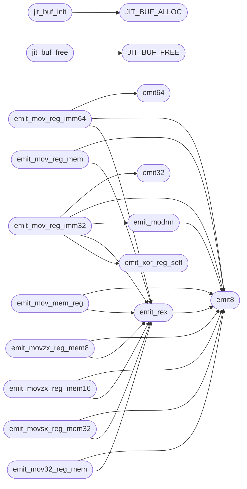

# `cvm2/cvm_jit_x86.c`

> Source: [cvm2/cvm_jit_x86.c:1](../../cvm2/cvm_jit_x86.c#L1) | language `c` | coverage 81.4% | [API index](../index.md)

## Contents

- **Functions:** [`jit_buf_init`](#jit_buf_init), [`jit_buf_free`](#jit_buf_free), [`jit_buf_reset`](#jit_buf_reset), [`jit_buf_failed`](#jit_buf_failed), [`emit8`](#emit8), [`emit16`](#emit16), [`emit32`](#emit32), [`emit64`](#emit64), [`emit_bytes`](#emit_bytes), [`emit_rex`](#emit_rex), [`emit_modrm`](#emit_modrm), [`emit_mov_reg_imm64`](#emit_mov_reg_imm64), [`emit_mov_reg_imm32`](#emit_mov_reg_imm32), [`emit_mov_reg_reg`](#emit_mov_reg_reg), [`emit_mov_reg_mem`](#emit_mov_reg_mem), [`emit_mov_mem_reg`](#emit_mov_mem_reg), [`emit_movzx_reg_mem8`](#emit_movzx_reg_mem8), [`emit_movzx_reg_mem16`](#emit_movzx_reg_mem16), [`emit_movsx_reg_mem32`](#emit_movsx_reg_mem32), [`emit_mov32_reg_mem`](#emit_mov32_reg_mem), [`emit_mov32_mem_reg`](#emit_mov32_mem_reg), [`emit_lea_sib`](#emit_lea_sib), [`emit_mov_reg_sib`](#emit_mov_reg_sib), [`emit_mov_sib_reg`](#emit_mov_sib_reg), [`emit_push`](#emit_push), [`emit_pop`](#emit_pop), [`emit_add_reg_reg`](#emit_add_reg_reg), [`emit_add_reg_imm32`](#emit_add_reg_imm32), [`emit_sub_reg_reg`](#emit_sub_reg_reg), [`emit_sub_reg_imm32`](#emit_sub_reg_imm32), [`emit_imul_reg_reg`](#emit_imul_reg_reg), [`emit_idiv_reg`](#emit_idiv_reg), [`emit_div_reg`](#emit_div_reg), [`emit_cqo`](#emit_cqo), [`emit_neg_reg`](#emit_neg_reg), [`emit_inc_reg`](#emit_inc_reg), [`emit_dec_reg`](#emit_dec_reg), [`emit_and_reg_imm32`](#emit_and_reg_imm32), [`emit_and_reg_reg`](#emit_and_reg_reg), [`emit_or_reg_reg`](#emit_or_reg_reg), [`emit_xor_reg_reg`](#emit_xor_reg_reg), [`emit_not_reg`](#emit_not_reg), [`emit_shl_reg_cl`](#emit_shl_reg_cl), [`emit_shr_reg_cl`](#emit_shr_reg_cl), [`emit_sar_reg_cl`](#emit_sar_reg_cl), [`emit_xor_reg_self`](#emit_xor_reg_self), [`emit_cmp_reg_reg`](#emit_cmp_reg_reg), [`emit_test_reg_reg`](#emit_test_reg_reg), [`emit_setcc`](#emit_setcc), [`emit_movzx_reg_reg8`](#emit_movzx_reg_reg8), [`emit_jmp_rel32`](#emit_jmp_rel32), [`emit_jcc_rel32`](#emit_jcc_rel32), [`emit_jmp_buf`](#emit_jmp_buf), [`emit_jcc_buf`](#emit_jcc_buf), [`jit_apply_patches`](#jit_apply_patches), [`emit_call_rel32`](#emit_call_rel32), [`emit_call_reg`](#emit_call_reg), [`emit_ret`](#emit_ret), [`emit_syscall`](#emit_syscall), [`emit_int3`](#emit_int3), [`emit_nop`](#emit_nop), [`emit_call_abs`](#emit_call_abs), [`emit_mov_mem_imm8`](#emit_mov_mem_imm8), [`emit_mov_mem_imm32`](#emit_mov_mem_imm32)
- **Macros:** [`JIT_BUF_ALLOC`](#jit_buf_alloc), [`JIT_BUF_FREE`](#jit_buf_free), [`JIT_BUF_ALLOC`](#jit_buf_alloc), [`JIT_BUF_FREE`](#jit_buf_free), [`JIT_BUF_FAILED`](#jit_buf_failed)

## Call Graph

Solid arrows stay in this module, dashed arrows leave it.



## Functions

<a id="jit_buf_init"></a>

### `jit_buf_init`

`function` | [cvm2/cvm_jit_x86.c:35](../../cvm2/cvm_jit_x86.c#L35)

```c
void jit_buf_init(JitBuf *b, size_t cap)
```

size_t patch_off;    /* offset in buf->code where rel32 lives size_t target;       /* absolute target offset in the same buffer } JitPatch; #define JIT_MAX_PATCHES 8192 typedef struct { JitPatch patches[JIT_MAX_PATCHES]; size_t   count; } JitPatches; /* ------------------------------------------------------------------ /*  Buffer lifecycle /* ------------------------------------------------------------------

**Parameters**

| Name | Type | Default | Description |
|---|---|---|---|
| `b` | `JitBuf *` |  |  |
| `cap` | `size_t` |  |  |

> **Inherited:** Documentation from [`jit_buf_init`](#jit_buf_init) (cvm2/cvm_jit_x86.h:63).

*Calls:* [`JIT_BUF_ALLOC`](#jit_buf_alloc)

---

<a id="jit_buf_free"></a>

### `jit_buf_free`

`function` | [cvm2/cvm_jit_x86.c:48](../../cvm2/cvm_jit_x86.c#L48)

```c
void jit_buf_free(JitBuf *b)
```

**Parameters**

| Name | Type | Default | Description |
|---|---|---|---|
| `b` | `JitBuf *` |  |  |

*Calls:* [`JIT_BUF_FREE`](#jit_buf_free)

---

<a id="jit_buf_reset"></a>

### `jit_buf_reset`

`function` | [cvm2/cvm_jit_x86.c:56](../../cvm2/cvm_jit_x86.c#L56)

```c
void jit_buf_reset(JitBuf *b)
```

**Parameters**

| Name | Type | Default | Description |
|---|---|---|---|
| `b` | `JitBuf *` |  |  |

---

<a id="jit_buf_failed"></a>

### `jit_buf_failed`

`function` | [cvm2/cvm_jit_x86.c:61](../../cvm2/cvm_jit_x86.c#L61)

```c
int jit_buf_failed(const JitBuf *b)
```

**Parameters**

| Name | Type | Default | Description |
|---|---|---|---|
| `b` | `JitBuf *` |  |  |

**Returns:** `int`

---

<a id="emit8"></a>

### `emit8`

`function` | [cvm2/cvm_jit_x86.c:84](../../cvm2/cvm_jit_x86.c#L84)

```c
void emit8(JitBuf *b, uint8_t v)
```

size_t   count; } JitPatches; /* ------------------------------------------------------------------ /*  Buffer lifecycle /* ------------------------------------------------------------------ void  jit_buf_init(JitBuf *b, size_t initial_cap); void  jit_buf_free(JitBuf *b); void  jit_buf_reset(JitBuf *b); int   jit_buf_failed(const JitBuf *b); /* ------------------------------------------------------------------ /*  Byte emission (little-endian) /* ------------------------------------------------------------------

**Parameters**

| Name | Type | Default | Description |
|---|---|---|---|
| `b` | `JitBuf *` |  |  |
| `v` | `uint8_t` |  |  |

> **Inherited:** Documentation from [`emit8`](#emit8) (cvm2/cvm_jit_x86.h:71).

*Called by:* [`emit_add_reg_imm32`](#emit_add_reg_imm32), [`emit_and_reg_imm32`](#emit_and_reg_imm32), [`emit_call_reg`](#emit_call_reg), [`emit_call_rel32`](#emit_call_rel32), [`emit_cqo`](#emit_cqo), [`emit_dec_reg`](#emit_dec_reg), [`emit_div_reg`](#emit_div_reg), [`emit_idiv_reg`](#emit_idiv_reg), [`emit_imul_reg_reg`](#emit_imul_reg_reg), [`emit_inc_reg`](#emit_inc_reg), [`emit_int3`](#emit_int3), [`emit_jcc_buf`](#emit_jcc_buf) and 33 more

---

<a id="emit16"></a>

### `emit16`

`function` | [cvm2/cvm_jit_x86.c:89](../../cvm2/cvm_jit_x86.c#L89)

```c
void emit16(JitBuf *b, uint16_t v)
```

**Parameters**

| Name | Type | Default | Description |
|---|---|---|---|
| `b` | `JitBuf *` |  |  |
| `v` | `uint16_t` |  |  |

---

<a id="emit32"></a>

### `emit32`

`function` | [cvm2/cvm_jit_x86.c:94](../../cvm2/cvm_jit_x86.c#L94)

```c
void emit32(JitBuf *b, uint32_t v)
```

**Parameters**

| Name | Type | Default | Description |
|---|---|---|---|
| `b` | `JitBuf *` |  |  |
| `v` | `uint32_t` |  |  |

*Called by:* [`emit_add_reg_imm32`](#emit_add_reg_imm32), [`emit_and_reg_imm32`](#emit_and_reg_imm32), [`emit_call_rel32`](#emit_call_rel32), [`emit_jcc_buf`](#emit_jcc_buf), [`emit_jcc_rel32`](#emit_jcc_rel32), [`emit_jmp_buf`](#emit_jmp_buf), [`emit_jmp_rel32`](#emit_jmp_rel32), [`emit_lea_sib`](#emit_lea_sib), [`emit_mov_mem_imm32`](#emit_mov_mem_imm32), [`emit_mov_reg_imm32`](#emit_mov_reg_imm32), [`emit_sub_reg_imm32`](#emit_sub_reg_imm32)

---

<a id="emit64"></a>

### `emit64`

`function` | [cvm2/cvm_jit_x86.c:99](../../cvm2/cvm_jit_x86.c#L99)

```c
void emit64(JitBuf *b, uint64_t v)
```

**Parameters**

| Name | Type | Default | Description |
|---|---|---|---|
| `b` | `JitBuf *` |  |  |
| `v` | `uint64_t` |  |  |

*Called by:* [`emit_mov_reg_imm64`](#emit_mov_reg_imm64)

---

<a id="emit_bytes"></a>

### `emit_bytes`

`function` | [cvm2/cvm_jit_x86.c:104](../../cvm2/cvm_jit_x86.c#L104)

```c
void emit_bytes(JitBuf *b, const void *data, size_t len)
```

**Parameters**

| Name | Type | Default | Description |
|---|---|---|---|
| `b` | `JitBuf *` |  |  |
| `data` | `void *` |  |  |
| `len` | `size_t` |  |  |

---

<a id="emit_rex"></a>

### `emit_rex`

`function` | [cvm2/cvm_jit_x86.c:114](../../cvm2/cvm_jit_x86.c#L114)

```c
void emit_rex(JitBuf *buf, int w, int r, int x, int rex_b)
```

REX prefix: 0100 WRXB

**Parameters**

| Name | Type | Default | Description |
|---|---|---|---|
| `buf` | `JitBuf *` |  |  |
| `w` | `int` |  |  |
| `r` | `int` |  |  |
| `x` | `int` |  |  |
| `rex_b` | `int` |  |  |

*Calls:* [`emit8`](#emit8)

*Called by:* [`emit_add_reg_imm32`](#emit_add_reg_imm32), [`emit_and_reg_imm32`](#emit_and_reg_imm32), [`emit_dec_reg`](#emit_dec_reg), [`emit_div_reg`](#emit_div_reg), [`emit_idiv_reg`](#emit_idiv_reg), [`emit_imul_reg_reg`](#emit_imul_reg_reg), [`emit_inc_reg`](#emit_inc_reg), [`emit_lea_sib`](#emit_lea_sib), [`emit_mov32_mem_reg`](#emit_mov32_mem_reg), [`emit_mov32_reg_mem`](#emit_mov32_reg_mem), [`emit_mov_mem_imm32`](#emit_mov_mem_imm32), [`emit_mov_mem_imm8`](#emit_mov_mem_imm8) and 16 more

---

<a id="emit_modrm"></a>

### `emit_modrm`

`function` | [cvm2/cvm_jit_x86.c:119](../../cvm2/cvm_jit_x86.c#L119)

```c
void emit_modrm(JitBuf *b, int mod, int reg, int rm)
```

ModRM byte

**Parameters**

| Name | Type | Default | Description |
|---|---|---|---|
| `b` | `JitBuf *` |  |  |
| `mod` | `int` |  |  |
| `reg` | `int` |  |  |
| `rm` | `int` |  |  |

*Calls:* [`emit8`](#emit8)

*Called by:* [`emit_add_reg_imm32`](#emit_add_reg_imm32), [`emit_and_reg_imm32`](#emit_and_reg_imm32), [`emit_call_reg`](#emit_call_reg), [`emit_dec_reg`](#emit_dec_reg), [`emit_div_reg`](#emit_div_reg), [`emit_idiv_reg`](#emit_idiv_reg), [`emit_imul_reg_reg`](#emit_imul_reg_reg), [`emit_inc_reg`](#emit_inc_reg), [`emit_lea_sib`](#emit_lea_sib), [`emit_mov_reg_imm32`](#emit_mov_reg_imm32), [`emit_mov_reg_sib`](#emit_mov_reg_sib), [`emit_mov_sib_reg`](#emit_mov_sib_reg) and 9 more

---

<a id="emit_mov_reg_imm64"></a>

### `emit_mov_reg_imm64`

`function` | [cvm2/cvm_jit_x86.c:145](../../cvm2/cvm_jit_x86.c#L145)

```c
void emit_mov_reg_imm64(JitBuf *b, int dst, uint64_t imm)
```

MOV r64, imm64  (10 bytes: REX.W B8+rd imm64)

**Parameters**

| Name | Type | Default | Description |
|---|---|---|---|
| `b` | `JitBuf *` |  |  |
| `dst` | `int` |  |  |
| `imm` | `uint64_t` |  |  |

> **Inherited:** Documentation from [`emit_mov_reg_imm64`](#emit_mov_reg_imm64) (cvm2/cvm_jit_x86.h:88).

*Calls:* [`emit64`](#emit64), [`emit8`](#emit8), [`emit_rex`](#emit_rex), [`reg_high3`](cvm2.cvm_jit_x86.h.md#reg_high3)

*Called by:* [`emit_call_abs`](#emit_call_abs)

---

<a id="emit_mov_reg_imm32"></a>

### `emit_mov_reg_imm32`

`function` | [cvm2/cvm_jit_x86.c:152](../../cvm2/cvm_jit_x86.c#L152)

```c
void emit_mov_reg_imm32(JitBuf *b, int dst, int32_t imm)
```

MOV r64, imm32  (sign-extended, 7 bytes: REX.W C7 /0 r/m imm32)

**Parameters**

| Name | Type | Default | Description |
|---|---|---|---|
| `b` | `JitBuf *` |  |  |
| `dst` | `int` |  |  |
| `imm` | `int32_t` |  |  |

> **Inherited:** Documentation from [`emit_mov_reg_imm32`](#emit_mov_reg_imm32) (cvm2/cvm_jit_x86.h:91).

*Calls:* [`emit32`](#emit32), [`emit8`](#emit8), [`emit_modrm`](#emit_modrm), [`emit_rex`](#emit_rex), [`emit_xor_reg_self`](#emit_xor_reg_self), [`reg_high3`](cvm2.cvm_jit_x86.h.md#reg_high3)

---

<a id="emit_mov_reg_reg"></a>

### `emit_mov_reg_reg`

`function` | [cvm2/cvm_jit_x86.c:165](../../cvm2/cvm_jit_x86.c#L165)

```c
void emit_mov_reg_reg(JitBuf *b, int dst, int src)
```

MOV r64, r64  (3 bytes: REX.W 89 /r)

**Parameters**

| Name | Type | Default | Description |
|---|---|---|---|
| `b` | `JitBuf *` |  |  |
| `dst` | `int` |  |  |
| `src` | `int` |  |  |

> **Inherited:** Documentation from [`emit_mov_reg_reg`](#emit_mov_reg_reg) (cvm2/cvm_jit_x86.h:94).

---

<a id="emit_mov_reg_mem"></a>

### `emit_mov_reg_mem`

`function` | [cvm2/cvm_jit_x86.c:171](../../cvm2/cvm_jit_x86.c#L171)

```c
void emit_mov_reg_mem(JitBuf *b, int dst, int base, int32_t disp)
```

MOV r64, [base + disp32]  (7 bytes: REX.W 8B /r mod=10)

**Parameters**

| Name | Type | Default | Description |
|---|---|---|---|
| `b` | `JitBuf *` |  |  |
| `dst` | `int` |  |  |
| `base` | `int` |  |  |
| `disp` | `int32_t` |  |  |

> **Inherited:** Documentation from [`emit_mov_reg_mem`](#emit_mov_reg_mem) (cvm2/cvm_jit_x86.h:97).

*Calls:* [`emit8`](#emit8), [`emit_rex`](#emit_rex), [`reg_high3`](cvm2.cvm_jit_x86.h.md#reg_high3)

---

<a id="emit_mov_mem_reg"></a>

### `emit_mov_mem_reg`

`function` | [cvm2/cvm_jit_x86.c:178](../../cvm2/cvm_jit_x86.c#L178)

```c
void emit_mov_mem_reg(JitBuf *b, int base, int32_t disp, int src)
```

MOV [base + disp32], r64  (7 bytes: REX.W 89 /r mod=10)

**Parameters**

| Name | Type | Default | Description |
|---|---|---|---|
| `b` | `JitBuf *` |  |  |
| `base` | `int` |  |  |
| `disp` | `int32_t` |  |  |
| `src` | `int` |  |  |

> **Inherited:** Documentation from [`emit_mov_mem_reg`](#emit_mov_mem_reg) (cvm2/cvm_jit_x86.h:100).

*Calls:* [`emit8`](#emit8), [`emit_rex`](#emit_rex), [`reg_high3`](cvm2.cvm_jit_x86.h.md#reg_high3)

---

<a id="emit_movzx_reg_mem8"></a>

### `emit_movzx_reg_mem8`

`function` | [cvm2/cvm_jit_x86.c:185](../../cvm2/cvm_jit_x86.c#L185)

```c
void emit_movzx_reg_mem8(JitBuf *b, int dst, int base, int32_t disp)
```

MOVZX r64, byte [base + disp32]  (4 bytes: REX.W 0F B6 /r mod=10)

**Parameters**

| Name | Type | Default | Description |
|---|---|---|---|
| `b` | `JitBuf *` |  |  |
| `dst` | `int` |  |  |
| `base` | `int` |  |  |
| `disp` | `int32_t` |  |  |

> **Inherited:** Documentation from [`emit_movzx_reg_mem8`](#emit_movzx_reg_mem8) (cvm2/cvm_jit_x86.h:103).

*Calls:* [`emit8`](#emit8), [`emit_rex`](#emit_rex), [`reg_high3`](cvm2.cvm_jit_x86.h.md#reg_high3)

---

<a id="emit_movzx_reg_mem16"></a>

### `emit_movzx_reg_mem16`

`function` | [cvm2/cvm_jit_x86.c:192](../../cvm2/cvm_jit_x86.c#L192)

```c
void emit_movzx_reg_mem16(JitBuf *b, int dst, int base, int32_t disp)
```

MOVZX r64, word [base + disp32]  (4 bytes: REX.W 0F B7 /r mod=10)

**Parameters**

| Name | Type | Default | Description |
|---|---|---|---|
| `b` | `JitBuf *` |  |  |
| `dst` | `int` |  |  |
| `base` | `int` |  |  |
| `disp` | `int32_t` |  |  |

> **Inherited:** Documentation from [`emit_movzx_reg_mem16`](#emit_movzx_reg_mem16) (cvm2/cvm_jit_x86.h:106).

*Calls:* [`emit8`](#emit8), [`emit_rex`](#emit_rex), [`reg_high3`](cvm2.cvm_jit_x86.h.md#reg_high3)

---

<a id="emit_movsx_reg_mem32"></a>

### `emit_movsx_reg_mem32`

`function` | [cvm2/cvm_jit_x86.c:199](../../cvm2/cvm_jit_x86.c#L199)

```c
void emit_movsx_reg_mem32(JitBuf *b, int dst, int base, int32_t disp)
```

MOVSX r64, dword [base + disp32]  (4 bytes: REX.W 63 /r mod=10)

**Parameters**

| Name | Type | Default | Description |
|---|---|---|---|
| `b` | `JitBuf *` |  |  |
| `dst` | `int` |  |  |
| `base` | `int` |  |  |
| `disp` | `int32_t` |  |  |

> **Inherited:** Documentation from [`emit_movsx_reg_mem32`](#emit_movsx_reg_mem32) (cvm2/cvm_jit_x86.h:109).

*Calls:* [`emit8`](#emit8), [`emit_rex`](#emit_rex), [`reg_high3`](cvm2.cvm_jit_x86.h.md#reg_high3)

---

<a id="emit_mov32_reg_mem"></a>

### `emit_mov32_reg_mem`

`function` | [cvm2/cvm_jit_x86.c:206](../../cvm2/cvm_jit_x86.c#L206)

```c
void emit_mov32_reg_mem(JitBuf *b, int dst, int base, int32_t disp)
```

MOV r32, [base + disp32]  (zero-extends to r64, 6 bytes: 8B /r mod=10)

**Parameters**

| Name | Type | Default | Description |
|---|---|---|---|
| `b` | `JitBuf *` |  |  |
| `dst` | `int` |  |  |
| `base` | `int` |  |  |
| `disp` | `int32_t` |  |  |

> **Inherited:** Documentation from [`emit_mov32_reg_mem`](#emit_mov32_reg_mem) (cvm2/cvm_jit_x86.h:112).

*Calls:* [`emit8`](#emit8), [`emit_rex`](#emit_rex), [`reg_high3`](cvm2.cvm_jit_x86.h.md#reg_high3)

---

<a id="emit_mov32_mem_reg"></a>

### `emit_mov32_mem_reg`

`function` | [cvm2/cvm_jit_x86.c:214](../../cvm2/cvm_jit_x86.c#L214)

```c
void emit_mov32_mem_reg(JitBuf *b, int base, int32_t disp, int src)
```

MOV [base + disp32], r32  (6 bytes: 89 /r mod=10)

**Parameters**

| Name | Type | Default | Description |
|---|---|---|---|
| `b` | `JitBuf *` |  |  |
| `base` | `int` |  |  |
| `disp` | `int32_t` |  |  |
| `src` | `int` |  |  |

> **Inherited:** Documentation from [`emit_mov32_mem_reg`](#emit_mov32_mem_reg) (cvm2/cvm_jit_x86.h:115).

*Calls:* [`emit8`](#emit8), [`emit_rex`](#emit_rex), [`reg_high3`](cvm2.cvm_jit_x86.h.md#reg_high3)

---

<a id="emit_lea_sib"></a>

### `emit_lea_sib`

`function` | [cvm2/cvm_jit_x86.c:222](../../cvm2/cvm_jit_x86.c#L222)

```c
void emit_lea_sib(JitBuf *b, int dst, int base, int index, int scale, int32_t disp)
```

LEA r64, [base + index*scale + disp] scale: 0=1, 1=2, 2=4, 3=8 If index == -1, encodes [base + disp] only.

**Parameters**

| Name | Type | Default | Description |
|---|---|---|---|
| `b` | `JitBuf *` |  |  |
| `dst` | `int` |  |  |
| `base` | `int` |  |  |
| `index` | `int` |  |  |
| `scale` | `int` |  |  |
| `disp` | `int32_t` |  |  |

> **Inherited:** Documentation from [`emit_lea_sib`](#emit_lea_sib) (cvm2/cvm_jit_x86.h:121).

*Calls:* [`emit32`](#emit32), [`emit8`](#emit8), [`emit_modrm`](#emit_modrm), [`emit_rex`](#emit_rex), [`reg_high3`](cvm2.cvm_jit_x86.h.md#reg_high3)

---

<a id="emit_mov_reg_sib"></a>

### `emit_mov_reg_sib`

`function` | [cvm2/cvm_jit_x86.c:259](../../cvm2/cvm_jit_x86.c#L259)

```c
void emit_mov_reg_sib(JitBuf *b, int dst, int base, int index, int scale)
```

MOV r64, [base + index*scale]  (no displacement) scale: 0=1, 1=2, 2=4, 3=8

**Parameters**

| Name | Type | Default | Description |
|---|---|---|---|
| `b` | `JitBuf *` |  |  |
| `dst` | `int` |  |  |
| `base` | `int` |  |  |
| `index` | `int` |  |  |
| `scale` | `int` |  |  |

> **Inherited:** Documentation from [`emit_mov_reg_sib`](#emit_mov_reg_sib) (cvm2/cvm_jit_x86.h:126).

*Calls:* [`emit8`](#emit8), [`emit_modrm`](#emit_modrm), [`emit_rex`](#emit_rex), [`reg_high3`](cvm2.cvm_jit_x86.h.md#reg_high3)

---

<a id="emit_mov_sib_reg"></a>

### `emit_mov_sib_reg`

`function` | [cvm2/cvm_jit_x86.c:267](../../cvm2/cvm_jit_x86.c#L267)

```c
void emit_mov_sib_reg(JitBuf *b, int base, int index, int scale, int src)
```

MOV [base + index*scale], r64  (no displacement)

**Parameters**

| Name | Type | Default | Description |
|---|---|---|---|
| `b` | `JitBuf *` |  |  |
| `base` | `int` |  |  |
| `index` | `int` |  |  |
| `scale` | `int` |  |  |
| `src` | `int` |  |  |

> **Inherited:** Documentation from [`emit_mov_sib_reg`](#emit_mov_sib_reg) (cvm2/cvm_jit_x86.h:129).

*Calls:* [`emit8`](#emit8), [`emit_modrm`](#emit_modrm), [`emit_rex`](#emit_rex), [`reg_high3`](cvm2.cvm_jit_x86.h.md#reg_high3)

---

<a id="emit_push"></a>

### `emit_push`

`function` | [cvm2/cvm_jit_x86.c:279](../../cvm2/cvm_jit_x86.c#L279)

```c
void emit_push(JitBuf *b, int reg)
```

PUSH r64 (1 or 2 bytes depending on register)

**Parameters**

| Name | Type | Default | Description |
|---|---|---|---|
| `b` | `JitBuf *` |  |  |
| `reg` | `int` |  |  |

> **Inherited:** Documentation from [`emit_push`](#emit_push) (cvm2/cvm_jit_x86.h:136).

*Calls:* [`emit8`](#emit8), [`reg_needs_rex`](cvm2.cvm_jit_x86.h.md#reg_needs_rex)

---

<a id="emit_pop"></a>

### `emit_pop`

`function` | [cvm2/cvm_jit_x86.c:285](../../cvm2/cvm_jit_x86.c#L285)

```c
void emit_pop(JitBuf *b, int reg)
```

POP r64

**Parameters**

| Name | Type | Default | Description |
|---|---|---|---|
| `b` | `JitBuf *` |  |  |
| `reg` | `int` |  |  |

> **Inherited:** Documentation from [`emit_pop`](#emit_pop) (cvm2/cvm_jit_x86.h:139).

*Calls:* [`emit8`](#emit8), [`reg_needs_rex`](cvm2.cvm_jit_x86.h.md#reg_needs_rex)

---

<a id="emit_add_reg_reg"></a>

### `emit_add_reg_reg`

`function` | [cvm2/cvm_jit_x86.c:295](../../cvm2/cvm_jit_x86.c#L295)

```c
void emit_add_reg_reg(JitBuf *b, int dst, int src)
```

ADD r64, r64  (REX.W 01 /r)

**Parameters**

| Name | Type | Default | Description |
|---|---|---|---|
| `b` | `JitBuf *` |  |  |
| `dst` | `int` |  |  |
| `src` | `int` |  |  |

> **Inherited:** Documentation from [`emit_add_reg_reg`](#emit_add_reg_reg) (cvm2/cvm_jit_x86.h:146).

---

<a id="emit_add_reg_imm32"></a>

### `emit_add_reg_imm32`

`function` | [cvm2/cvm_jit_x86.c:299](../../cvm2/cvm_jit_x86.c#L299)

```c
void emit_add_reg_imm32(JitBuf *b, int dst, int32_t imm)
```

ADD r64, imm32  (sign-extended)

**Parameters**

| Name | Type | Default | Description |
|---|---|---|---|
| `b` | `JitBuf *` |  |  |
| `dst` | `int` |  |  |
| `imm` | `int32_t` |  |  |

> **Inherited:** Documentation from [`emit_add_reg_imm32`](#emit_add_reg_imm32) (cvm2/cvm_jit_x86.h:149).

*Calls:* [`emit32`](#emit32), [`emit8`](#emit8), [`emit_modrm`](#emit_modrm), [`emit_rex`](#emit_rex), [`reg_high3`](cvm2.cvm_jit_x86.h.md#reg_high3)

---

<a id="emit_sub_reg_reg"></a>

### `emit_sub_reg_reg`

`function` | [cvm2/cvm_jit_x86.c:308](../../cvm2/cvm_jit_x86.c#L308)

```c
void emit_sub_reg_reg(JitBuf *b, int dst, int src)
```

SUB r64, r64  (REX.W 29 /r)

**Parameters**

| Name | Type | Default | Description |
|---|---|---|---|
| `b` | `JitBuf *` |  |  |
| `dst` | `int` |  |  |
| `src` | `int` |  |  |

> **Inherited:** Documentation from [`emit_sub_reg_reg`](#emit_sub_reg_reg) (cvm2/cvm_jit_x86.h:152).

---

<a id="emit_sub_reg_imm32"></a>

### `emit_sub_reg_imm32`

`function` | [cvm2/cvm_jit_x86.c:312](../../cvm2/cvm_jit_x86.c#L312)

```c
void emit_sub_reg_imm32(JitBuf *b, int dst, int32_t imm)
```

SUB r64, imm32

**Parameters**

| Name | Type | Default | Description |
|---|---|---|---|
| `b` | `JitBuf *` |  |  |
| `dst` | `int` |  |  |
| `imm` | `int32_t` |  |  |

> **Inherited:** Documentation from [`emit_sub_reg_imm32`](#emit_sub_reg_imm32) (cvm2/cvm_jit_x86.h:155).

*Calls:* [`emit32`](#emit32), [`emit8`](#emit8), [`emit_modrm`](#emit_modrm), [`emit_rex`](#emit_rex), [`reg_high3`](cvm2.cvm_jit_x86.h.md#reg_high3)

---

<a id="emit_imul_reg_reg"></a>

### `emit_imul_reg_reg`

`function` | [cvm2/cvm_jit_x86.c:320](../../cvm2/cvm_jit_x86.c#L320)

```c
void emit_imul_reg_reg(JitBuf *b, int dst, int src)
```

IMUL r64, r64  (REX.W 0F AF /r)

**Parameters**

| Name | Type | Default | Description |
|---|---|---|---|
| `b` | `JitBuf *` |  |  |
| `dst` | `int` |  |  |
| `src` | `int` |  |  |

> **Inherited:** Documentation from [`emit_imul_reg_reg`](#emit_imul_reg_reg) (cvm2/cvm_jit_x86.h:158).

*Calls:* [`emit8`](#emit8), [`emit_modrm`](#emit_modrm), [`emit_rex`](#emit_rex), [`reg_high3`](cvm2.cvm_jit_x86.h.md#reg_high3)

---

<a id="emit_idiv_reg"></a>

### `emit_idiv_reg`

`function` | [cvm2/cvm_jit_x86.c:327](../../cvm2/cvm_jit_x86.c#L327)

```c
void emit_idiv_reg(JitBuf *b, int divisor)
```

IDIV r64  (divides RDX:RAX by r64, quotient in RAX, remainder in RDX) Requires RDX=0 before unsigned, or use CQO for signed.

**Parameters**

| Name | Type | Default | Description |
|---|---|---|---|
| `b` | `JitBuf *` |  |  |
| `divisor` | `int` |  |  |

> **Inherited:** Documentation from [`emit_idiv_reg`](#emit_idiv_reg) (cvm2/cvm_jit_x86.h:162).

*Calls:* [`emit8`](#emit8), [`emit_modrm`](#emit_modrm), [`emit_rex`](#emit_rex), [`reg_high3`](cvm2.cvm_jit_x86.h.md#reg_high3)

---

<a id="emit_div_reg"></a>

### `emit_div_reg`

`function` | [cvm2/cvm_jit_x86.c:334](../../cvm2/cvm_jit_x86.c#L334)

```c
void emit_div_reg(JitBuf *b, int divisor)
```

DIV r64  (divides RDX:RAX by r64, unsigned; quotient RAX, remainder RDX) Requires RDX=0 before (xor edx,edx).

**Parameters**

| Name | Type | Default | Description |
|---|---|---|---|
| `b` | `JitBuf *` |  |  |
| `divisor` | `int` |  |  |

> **Inherited:** Documentation from [`emit_div_reg`](#emit_div_reg) (cvm2/cvm_jit_x86.h:166).

*Calls:* [`emit8`](#emit8), [`emit_modrm`](#emit_modrm), [`emit_rex`](#emit_rex), [`reg_high3`](cvm2.cvm_jit_x86.h.md#reg_high3)

---

<a id="emit_cqo"></a>

### `emit_cqo`

`function` | [cvm2/cvm_jit_x86.c:341](../../cvm2/cvm_jit_x86.c#L341)

```c
void emit_cqo(JitBuf *b)
```

CQO  (sign-extend RAX into RDX:RAX)

**Parameters**

| Name | Type | Default | Description |
|---|---|---|---|
| `b` | `JitBuf *` |  |  |

> **Inherited:** Documentation from [`emit_cqo`](#emit_cqo) (cvm2/cvm_jit_x86.h:169).

*Calls:* [`emit8`](#emit8)

---

<a id="emit_neg_reg"></a>

### `emit_neg_reg`

`function` | [cvm2/cvm_jit_x86.c:347](../../cvm2/cvm_jit_x86.c#L347)

```c
void emit_neg_reg(JitBuf *b, int reg)
```

NEG r64  (REX.W F7 /3)

**Parameters**

| Name | Type | Default | Description |
|---|---|---|---|
| `b` | `JitBuf *` |  |  |
| `reg` | `int` |  |  |

> **Inherited:** Documentation from [`emit_neg_reg`](#emit_neg_reg) (cvm2/cvm_jit_x86.h:172).

*Calls:* [`emit8`](#emit8), [`emit_modrm`](#emit_modrm), [`emit_rex`](#emit_rex), [`reg_high3`](cvm2.cvm_jit_x86.h.md#reg_high3)

---

<a id="emit_inc_reg"></a>

### `emit_inc_reg`

`function` | [cvm2/cvm_jit_x86.c:354](../../cvm2/cvm_jit_x86.c#L354)

```c
void emit_inc_reg(JitBuf *b, int reg)
```

INC r64  (REX.W FF /0) -- 3 bytes, or use add reg,1 (7 bytes but avoids false dependencies)

**Parameters**

| Name | Type | Default | Description |
|---|---|---|---|
| `b` | `JitBuf *` |  |  |
| `reg` | `int` |  |  |

> **Inherited:** Documentation from [`emit_inc_reg`](#emit_inc_reg) (cvm2/cvm_jit_x86.h:175).

*Calls:* [`emit8`](#emit8), [`emit_modrm`](#emit_modrm), [`emit_rex`](#emit_rex), [`reg_high3`](cvm2.cvm_jit_x86.h.md#reg_high3)

---

<a id="emit_dec_reg"></a>

### `emit_dec_reg`

`function` | [cvm2/cvm_jit_x86.c:361](../../cvm2/cvm_jit_x86.c#L361)

```c
void emit_dec_reg(JitBuf *b, int reg)
```

DEC r64

**Parameters**

| Name | Type | Default | Description |
|---|---|---|---|
| `b` | `JitBuf *` |  |  |
| `reg` | `int` |  |  |

> **Inherited:** Documentation from [`emit_dec_reg`](#emit_dec_reg) (cvm2/cvm_jit_x86.h:178).

*Calls:* [`emit8`](#emit8), [`emit_modrm`](#emit_modrm), [`emit_rex`](#emit_rex), [`reg_high3`](cvm2.cvm_jit_x86.h.md#reg_high3)

---

<a id="emit_and_reg_imm32"></a>

### `emit_and_reg_imm32`

`function` | [cvm2/cvm_jit_x86.c:372](../../cvm2/cvm_jit_x86.c#L372)

```c
void emit_and_reg_imm32(JitBuf *buf, int dst, int32_t imm)
```

AND r64, imm32

**Parameters**

| Name | Type | Default | Description |
|---|---|---|---|
| `buf` | `JitBuf *` |  |  |
| `dst` | `int` |  |  |
| `imm` | `int32_t` |  |  |

> **Inherited:** Documentation from [`emit_and_reg_imm32`](#emit_and_reg_imm32) (cvm2/cvm_jit_x86.h:272).

*Calls:* [`emit32`](#emit32), [`emit8`](#emit8), [`emit_modrm`](#emit_modrm), [`emit_rex`](#emit_rex), [`reg_high3`](cvm2.cvm_jit_x86.h.md#reg_high3)

---

<a id="emit_and_reg_reg"></a>

### `emit_and_reg_reg`

`function` | [cvm2/cvm_jit_x86.c:380](../../cvm2/cvm_jit_x86.c#L380)

```c
void emit_and_reg_reg(JitBuf *b, int dst, int src)
```

AND r64, r64

**Parameters**

| Name | Type | Default | Description |
|---|---|---|---|
| `b` | `JitBuf *` |  |  |
| `dst` | `int` |  |  |
| `src` | `int` |  |  |

> **Inherited:** Documentation from [`emit_and_reg_reg`](#emit_and_reg_reg) (cvm2/cvm_jit_x86.h:185).

---

<a id="emit_or_reg_reg"></a>

### `emit_or_reg_reg`

`function` | [cvm2/cvm_jit_x86.c:384](../../cvm2/cvm_jit_x86.c#L384)

```c
void emit_or_reg_reg(JitBuf *b, int dst, int src)
```

OR r64, r64

**Parameters**

| Name | Type | Default | Description |
|---|---|---|---|
| `b` | `JitBuf *` |  |  |
| `dst` | `int` |  |  |
| `src` | `int` |  |  |

> **Inherited:** Documentation from [`emit_or_reg_reg`](#emit_or_reg_reg) (cvm2/cvm_jit_x86.h:188).

---

<a id="emit_xor_reg_reg"></a>

### `emit_xor_reg_reg`

`function` | [cvm2/cvm_jit_x86.c:388](../../cvm2/cvm_jit_x86.c#L388)

```c
void emit_xor_reg_reg(JitBuf *b, int dst, int src)
```

XOR r64, r64

**Parameters**

| Name | Type | Default | Description |
|---|---|---|---|
| `b` | `JitBuf *` |  |  |
| `dst` | `int` |  |  |
| `src` | `int` |  |  |

> **Inherited:** Documentation from [`emit_xor_reg_reg`](#emit_xor_reg_reg) (cvm2/cvm_jit_x86.h:191).

---

<a id="emit_not_reg"></a>

### `emit_not_reg`

`function` | [cvm2/cvm_jit_x86.c:392](../../cvm2/cvm_jit_x86.c#L392)

```c
void emit_not_reg(JitBuf *b, int reg)
```

NOT r64

**Parameters**

| Name | Type | Default | Description |
|---|---|---|---|
| `b` | `JitBuf *` |  |  |
| `reg` | `int` |  |  |

> **Inherited:** Documentation from [`emit_not_reg`](#emit_not_reg) (cvm2/cvm_jit_x86.h:194).

*Calls:* [`emit8`](#emit8), [`emit_modrm`](#emit_modrm), [`emit_rex`](#emit_rex), [`reg_high3`](cvm2.cvm_jit_x86.h.md#reg_high3)

---

<a id="emit_shl_reg_cl"></a>

### `emit_shl_reg_cl`

`function` | [cvm2/cvm_jit_x86.c:399](../../cvm2/cvm_jit_x86.c#L399)

```c
void emit_shl_reg_cl(JitBuf *b, int reg)
```

SHL r64, CL  (shift left by CL)

**Parameters**

| Name | Type | Default | Description |
|---|---|---|---|
| `b` | `JitBuf *` |  |  |
| `reg` | `int` |  |  |

> **Inherited:** Documentation from [`emit_shl_reg_cl`](#emit_shl_reg_cl) (cvm2/cvm_jit_x86.h:197).

*Calls:* [`emit8`](#emit8), [`emit_modrm`](#emit_modrm), [`emit_rex`](#emit_rex), [`reg_high3`](cvm2.cvm_jit_x86.h.md#reg_high3)

---

<a id="emit_shr_reg_cl"></a>

### `emit_shr_reg_cl`

`function` | [cvm2/cvm_jit_x86.c:406](../../cvm2/cvm_jit_x86.c#L406)

```c
void emit_shr_reg_cl(JitBuf *b, int reg)
```

SHR r64, CL  (logical shift right)

**Parameters**

| Name | Type | Default | Description |
|---|---|---|---|
| `b` | `JitBuf *` |  |  |
| `reg` | `int` |  |  |

> **Inherited:** Documentation from [`emit_shr_reg_cl`](#emit_shr_reg_cl) (cvm2/cvm_jit_x86.h:200).

*Calls:* [`emit8`](#emit8), [`emit_modrm`](#emit_modrm), [`emit_rex`](#emit_rex), [`reg_high3`](cvm2.cvm_jit_x86.h.md#reg_high3)

---

<a id="emit_sar_reg_cl"></a>

### `emit_sar_reg_cl`

`function` | [cvm2/cvm_jit_x86.c:413](../../cvm2/cvm_jit_x86.c#L413)

```c
void emit_sar_reg_cl(JitBuf *b, int reg)
```

SAR r64, CL  (arithmetic shift right)

**Parameters**

| Name | Type | Default | Description |
|---|---|---|---|
| `b` | `JitBuf *` |  |  |
| `reg` | `int` |  |  |

> **Inherited:** Documentation from [`emit_sar_reg_cl`](#emit_sar_reg_cl) (cvm2/cvm_jit_x86.h:203).

*Calls:* [`emit8`](#emit8), [`emit_modrm`](#emit_modrm), [`emit_rex`](#emit_rex), [`reg_high3`](cvm2.cvm_jit_x86.h.md#reg_high3)

---

<a id="emit_xor_reg_self"></a>

### `emit_xor_reg_self`

`function` | [cvm2/cvm_jit_x86.c:420](../../cvm2/cvm_jit_x86.c#L420)

```c
void emit_xor_reg_self(JitBuf *b, int reg)
```

XOR reg, reg (zero-idiom, 3 bytes)

**Parameters**

| Name | Type | Default | Description |
|---|---|---|---|
| `b` | `JitBuf *` |  |  |
| `reg` | `int` |  |  |

> **Inherited:** Documentation from [`emit_xor_reg_self`](#emit_xor_reg_self) (cvm2/cvm_jit_x86.h:206).

*Calls:* [`emit8`](#emit8), [`emit_modrm`](#emit_modrm)

*Called by:* [`emit_mov_reg_imm32`](#emit_mov_reg_imm32)

---

<a id="emit_cmp_reg_reg"></a>

### `emit_cmp_reg_reg`

`function` | [cvm2/cvm_jit_x86.c:430](../../cvm2/cvm_jit_x86.c#L430)

```c
void emit_cmp_reg_reg(JitBuf *buf, int a, int breg)
```

CMP r64, r64  (REX.W 39 /r)

**Parameters**

| Name | Type | Default | Description |
|---|---|---|---|
| `buf` | `JitBuf *` |  |  |
| `a` | `int` |  |  |
| `breg` | `int` |  |  |

> **Inherited:** Documentation from [`emit_cmp_reg_reg`](#emit_cmp_reg_reg) (cvm2/cvm_jit_x86.h:213).

---

<a id="emit_test_reg_reg"></a>

### `emit_test_reg_reg`

`function` | [cvm2/cvm_jit_x86.c:435](../../cvm2/cvm_jit_x86.c#L435)

```c
void emit_test_reg_reg(JitBuf *buf, int a, int breg)
```

TEST r64, r64  (REX.W 85 /r)

**Parameters**

| Name | Type | Default | Description |
|---|---|---|---|
| `buf` | `JitBuf *` |  |  |
| `a` | `int` |  |  |
| `breg` | `int` |  |  |

> **Inherited:** Documentation from [`emit_test_reg_reg`](#emit_test_reg_reg) (cvm2/cvm_jit_x86.h:216).

---

<a id="emit_setcc"></a>

### `emit_setcc`

`function` | [cvm2/cvm_jit_x86.c:440](../../cvm2/cvm_jit_x86.c#L440)

```c
void emit_setcc(JitBuf *b, int cc, int dst)
```

SETcc r/m8  (0F 9x /0)

**Parameters**

| Name | Type | Default | Description |
|---|---|---|---|
| `b` | `JitBuf *` |  |  |
| `cc` | `int` |  |  |
| `dst` | `int` |  |  |

> **Inherited:** Documentation from [`emit_setcc`](#emit_setcc) (cvm2/cvm_jit_x86.h:219).

*Calls:* [`emit8`](#emit8), [`emit_modrm`](#emit_modrm), [`reg_needs_rex`](cvm2.cvm_jit_x86.h.md#reg_needs_rex)

---

<a id="emit_movzx_reg_reg8"></a>

### `emit_movzx_reg_reg8`

`function` | [cvm2/cvm_jit_x86.c:449](../../cvm2/cvm_jit_x86.c#L449)

```c
void emit_movzx_reg_reg8(JitBuf *buf, int dst, int src)
```

MOVZX r64, r/m8  (REX.W 0F B6 /r) -- used for SETcc zero-extension

**Parameters**

| Name | Type | Default | Description |
|---|---|---|---|
| `buf` | `JitBuf *` |  |  |
| `dst` | `int` |  |  |
| `src` | `int` |  |  |

> **Inherited:** Documentation from [`emit_movzx_reg_reg8`](#emit_movzx_reg_reg8) (cvm2/cvm_jit_x86.h:275).

*Calls:* [`emit8`](#emit8), [`emit_modrm`](#emit_modrm), [`emit_rex`](#emit_rex), [`reg_high3`](cvm2.cvm_jit_x86.h.md#reg_high3)

---

<a id="emit_jmp_rel32"></a>

### `emit_jmp_rel32`

`function` | [cvm2/cvm_jit_x86.c:460](../../cvm2/cvm_jit_x86.c#L460)

```c
size_t emit_jmp_rel32(JitBuf *b, int32_t rel)
```

JMP rel32  (E9 imm32) -- returns offset of the rel32 for patching

**Parameters**

| Name | Type | Default | Description |
|---|---|---|---|
| `b` | `JitBuf *` |  |  |
| `rel` | `int32_t` |  |  |

**Returns:** `size_t`

> **Inherited:** Documentation from [`emit_jmp_rel32`](#emit_jmp_rel32) (cvm2/cvm_jit_x86.h:226).

*Calls:* [`emit32`](#emit32), [`emit8`](#emit8)

---

<a id="emit_jcc_rel32"></a>

### `emit_jcc_rel32`

`function` | [cvm2/cvm_jit_x86.c:467](../../cvm2/cvm_jit_x86.c#L467)

```c
size_t emit_jcc_rel32(JitBuf *b, int cc, int32_t rel)
```

Jcc rel32  (0F 8x imm32) -- returns offset of the rel32 for patching

**Parameters**

| Name | Type | Default | Description |
|---|---|---|---|
| `b` | `JitBuf *` |  |  |
| `cc` | `int` |  |  |
| `rel` | `int32_t` |  |  |

**Returns:** `size_t`

> **Inherited:** Documentation from [`emit_jcc_rel32`](#emit_jcc_rel32) (cvm2/cvm_jit_x86.h:229).

*Calls:* [`emit32`](#emit32), [`emit8`](#emit8)

---

<a id="emit_jmp_buf"></a>

### `emit_jmp_buf`

`function` | [cvm2/cvm_jit_x86.c:475](../../cvm2/cvm_jit_x86.c#L475)

```c
void emit_jmp_buf(JitBuf *b, size_t target, JitPatches *p)
```

JMP to absolute offset within the buffer (emits rel32, records patch)

**Parameters**

| Name | Type | Default | Description |
|---|---|---|---|
| `b` | `JitBuf *` |  |  |
| `target` | `size_t` |  |  |
| `p` | `JitPatches *` |  |  |

> **Inherited:** Documentation from [`emit_jmp_buf`](#emit_jmp_buf) (cvm2/cvm_jit_x86.h:232).

*Calls:* [`emit32`](#emit32), [`emit8`](#emit8)

---

<a id="emit_jcc_buf"></a>

### `emit_jcc_buf`

`function` | [cvm2/cvm_jit_x86.c:487](../../cvm2/cvm_jit_x86.c#L487)

```c
void emit_jcc_buf(JitBuf *b, int cc, size_t target, JitPatches *p)
```

Jcc to absolute offset within the buffer

**Parameters**

| Name | Type | Default | Description |
|---|---|---|---|
| `b` | `JitBuf *` |  |  |
| `cc` | `int` |  |  |
| `target` | `size_t` |  |  |
| `p` | `JitPatches *` |  |  |

> **Inherited:** Documentation from [`emit_jcc_buf`](#emit_jcc_buf) (cvm2/cvm_jit_x86.h:235).

*Calls:* [`emit32`](#emit32), [`emit8`](#emit8)

---

<a id="jit_apply_patches"></a>

### `jit_apply_patches`

`function` | [cvm2/cvm_jit_x86.c:500](../../cvm2/cvm_jit_x86.c#L500)

```c
void jit_apply_patches(JitBuf *b, const JitPatches *p)
```

Apply all patches: for each patch, compute rel32 = target - (patch_off + 4)

**Parameters**

| Name | Type | Default | Description |
|---|---|---|---|
| `b` | `JitBuf *` |  |  |
| `p` | `JitPatches *` |  |  |

> **Inherited:** Documentation from [`jit_apply_patches`](#jit_apply_patches) (cvm2/cvm_jit_x86.h:238).

---

<a id="emit_call_rel32"></a>

### `emit_call_rel32`

`function` | [cvm2/cvm_jit_x86.c:512](../../cvm2/cvm_jit_x86.c#L512)

```c
size_t emit_call_rel32(JitBuf *b, int32_t rel)
```

CALL rel32  (E8 imm32)

**Parameters**

| Name | Type | Default | Description |
|---|---|---|---|
| `b` | `JitBuf *` |  |  |
| `rel` | `int32_t` |  |  |

**Returns:** `size_t`

> **Inherited:** Documentation from [`emit_call_rel32`](#emit_call_rel32) (cvm2/cvm_jit_x86.h:241).

*Calls:* [`emit32`](#emit32), [`emit8`](#emit8)

---

<a id="emit_call_reg"></a>

### `emit_call_reg`

`function` | [cvm2/cvm_jit_x86.c:519](../../cvm2/cvm_jit_x86.c#L519)

```c
void emit_call_reg(JitBuf *b, int reg)
```

CALL r/m64  (FF /2, 2 bytes)

**Parameters**

| Name | Type | Default | Description |
|---|---|---|---|
| `b` | `JitBuf *` |  |  |
| `reg` | `int` |  |  |

> **Inherited:** Documentation from [`emit_call_reg`](#emit_call_reg) (cvm2/cvm_jit_x86.h:244).

*Calls:* [`emit8`](#emit8), [`emit_modrm`](#emit_modrm), [`reg_needs_rex`](cvm2.cvm_jit_x86.h.md#reg_needs_rex)

*Called by:* [`emit_call_abs`](#emit_call_abs)

---

<a id="emit_ret"></a>

### `emit_ret`

`function` | [cvm2/cvm_jit_x86.c:527](../../cvm2/cvm_jit_x86.c#L527)

```c
void emit_ret(JitBuf *b)
```

RET  (C3)

**Parameters**

| Name | Type | Default | Description |
|---|---|---|---|
| `b` | `JitBuf *` |  |  |

> **Inherited:** Documentation from [`emit_ret`](#emit_ret) (cvm2/cvm_jit_x86.h:247).

*Calls:* [`emit8`](#emit8)

---

<a id="emit_syscall"></a>

### `emit_syscall`

`function` | [cvm2/cvm_jit_x86.c:535](../../cvm2/cvm_jit_x86.c#L535)

```c
void emit_syscall(JitBuf *b)
```

SYSCALL  (0F 05)

**Parameters**

| Name | Type | Default | Description |
|---|---|---|---|
| `b` | `JitBuf *` |  |  |

> **Inherited:** Documentation from [`emit_syscall`](#emit_syscall) (cvm2/cvm_jit_x86.h:254).

*Calls:* [`emit8`](#emit8)

---

<a id="emit_int3"></a>

### `emit_int3`

`function` | [cvm2/cvm_jit_x86.c:540](../../cvm2/cvm_jit_x86.c#L540)

```c
void emit_int3(JitBuf *b)
```

INT3  (CC) -- debug breakpoint

**Parameters**

| Name | Type | Default | Description |
|---|---|---|---|
| `b` | `JitBuf *` |  |  |

> **Inherited:** Documentation from [`emit_int3`](#emit_int3) (cvm2/cvm_jit_x86.h:257).

*Calls:* [`emit8`](#emit8)

---

<a id="emit_nop"></a>

### `emit_nop`

`function` | [cvm2/cvm_jit_x86.c:544](../../cvm2/cvm_jit_x86.c#L544)

```c
void emit_nop(JitBuf *b)
```

NOP  (90)

**Parameters**

| Name | Type | Default | Description |
|---|---|---|---|
| `b` | `JitBuf *` |  |  |

> **Inherited:** Documentation from [`emit_nop`](#emit_nop) (cvm2/cvm_jit_x86.h:260).

*Calls:* [`emit8`](#emit8)

---

<a id="emit_call_abs"></a>

### `emit_call_abs`

`function` | [cvm2/cvm_jit_x86.c:552](../../cvm2/cvm_jit_x86.c#L552)

```c
void emit_call_abs(JitBuf *b, void *func, int scratch)
```

Emit a CALL to a C function pointer (trampoline-free, uses absolute call).

Loads the function address into a scratch register and calls it. Clobbers: the scratch register used.

**Parameters**

| Name | Type | Default | Description |
|---|---|---|---|
| `b` | `JitBuf *` |  |  |
| `func` | `void *` |  |  |
| `scratch` | `int` |  |  |

> **Inherited:** Documentation from [`emit_call_abs`](#emit_call_abs) (cvm2/cvm_jit_x86.h:269).

*Calls:* [`emit_call_reg`](#emit_call_reg), [`emit_mov_reg_imm64`](#emit_mov_reg_imm64)

---

<a id="emit_mov_mem_imm8"></a>

### `emit_mov_mem_imm8`

`function` | [cvm2/cvm_jit_x86.c:561](../../cvm2/cvm_jit_x86.c#L561)

```c
void emit_mov_mem_imm8(JitBuf *b, int base, int32_t disp, uint8_t imm)
```

MOV byte [base + disp], imm8  (REX.C6 /0)

**Parameters**

| Name | Type | Default | Description |
|---|---|---|---|
| `b` | `JitBuf *` |  |  |
| `base` | `int` |  |  |
| `disp` | `int32_t` |  |  |
| `imm` | `uint8_t` |  |  |

> **Inherited:** Documentation from [`emit_mov_mem_imm8`](#emit_mov_mem_imm8) (cvm2/cvm_jit_x86.h:288).

*Calls:* [`emit8`](#emit8), [`emit_rex`](#emit_rex), [`reg_high3`](cvm2.cvm_jit_x86.h.md#reg_high3)

---

<a id="emit_mov_mem_imm32"></a>

### `emit_mov_mem_imm32`

`function` | [cvm2/cvm_jit_x86.c:569](../../cvm2/cvm_jit_x86.c#L569)

```c
void emit_mov_mem_imm32(JitBuf *b, int base, int32_t disp, int32_t imm)
```

MOV qword [base + disp], imm32 (sign-extended)  (REX.W C7 /0)

**Parameters**

| Name | Type | Default | Description |
|---|---|---|---|
| `b` | `JitBuf *` |  |  |
| `base` | `int` |  |  |
| `disp` | `int32_t` |  |  |
| `imm` | `int32_t` |  |  |

> **Inherited:** Documentation from [`emit_mov_mem_imm32`](#emit_mov_mem_imm32) (cvm2/cvm_jit_x86.h:291).

*Calls:* [`emit32`](#emit32), [`emit8`](#emit8), [`emit_rex`](#emit_rex), [`reg_high3`](cvm2.cvm_jit_x86.h.md#reg_high3)

---

## Macros

<a id="jit_buf_alloc"></a>

### `JIT_BUF_ALLOC`

`macro` | [cvm2/cvm_jit_x86.c:26](../../cvm2/cvm_jit_x86.c#L26)

```c
#define JIT_BUF_ALLOC(sz)
```

*Called by:* [`jit_buf_init`](#jit_buf_init)

---

<a id="jit_buf_free"></a>

### `JIT_BUF_FREE`

`macro` | [cvm2/cvm_jit_x86.c:27](../../cvm2/cvm_jit_x86.c#L27)

```c
#define JIT_BUF_FREE(p, sz)
```

*Called by:* [`jit_buf_free`](#jit_buf_free)

---

<a id="jit_buf_alloc"></a>

### `JIT_BUF_ALLOC`

`macro` | [cvm2/cvm_jit_x86.c:29](../../cvm2/cvm_jit_x86.c#L29)

```c
#define JIT_BUF_ALLOC(sz)
```

---

<a id="jit_buf_free"></a>

### `JIT_BUF_FREE`

`macro` | [cvm2/cvm_jit_x86.c:31](../../cvm2/cvm_jit_x86.c#L31)

```c
#define JIT_BUF_FREE(p, sz)
```

---

<a id="jit_buf_failed"></a>

### `JIT_BUF_FAILED`

`macro` | [cvm2/cvm_jit_x86.c:32](../../cvm2/cvm_jit_x86.c#L32)

```c
#define JIT_BUF_FAILED
```

---
