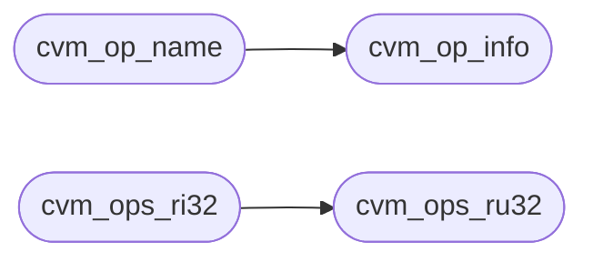

# `cvm2/cvm_ops.c`

> Source: [cvm2/cvm_ops.c:1](../../cvm2/cvm_ops.c#L1) | language `c` | coverage 37.5% | [API index](../index.md)

## Contents

- **Functions:** [`cvm_op_info`](#cvm_op_info), [`cvm_op_name`](#cvm_op_name), [`cvm_ops_r8`](#cvm_ops_r8), [`cvm_ops_ru32`](#cvm_ops_ru32), [`cvm_ops_ri32`](#cvm_ops_ri32), [`cvm_ops_ri64`](#cvm_ops_ri64)
- **Macros:** [`OP_INFOS_LEN`](#op_infos_len)

## Call Graph

Solid arrows stay in this module, dashed arrows leave it.



## Functions

<a id="cvm_op_info"></a>

### `cvm_op_info`

`function` `const` | [cvm2/cvm_ops.c:72](../../cvm2/cvm_ops.c#L72)

```c
const CvmOpInfo *cvm_op_info(uint8_t opcode)
```

Metadata for one opcode, or NULL when the opcode is not defined.

**Parameters**

| Name | Type | Default | Description |
|---|---|---|---|
| `opcode` | `uint8_t` |  |  |

**Returns:** `CvmOpInfo *`

> **Inherited:** Documentation from [`cvm_op_info`](#cvm_op_info) (cvm2/cvm_ops.h:38).

*Called by:* [`cvm_op_name`](#cvm_op_name)

---

<a id="cvm_op_name"></a>

### `cvm_op_name`

`function` `const` | [cvm2/cvm_ops.c:78](../../cvm2/cvm_ops.c#L78)

```c
const char *cvm_op_name(uint8_t opcode)
```

Mnemonic for one opcode, or NULL when the opcode is not defined.

**Parameters**

| Name | Type | Default | Description |
|---|---|---|---|
| `opcode` | `uint8_t` |  |  |

**Returns:** `char *`

> **Inherited:** Documentation from [`cvm_op_name`](#cvm_op_name) (cvm2/cvm_ops.h:41).

*Calls:* [`cvm_op_info`](#cvm_op_info)

---

<a id="cvm_ops_r8"></a>

### `cvm_ops_r8`

`function` | [cvm2/cvm_ops.c:83](../../cvm2/cvm_ops.c#L83)

```c
int cvm_ops_r8(const uint8_t *code, size_t size, size_t off, uint8_t *out)
```

**Parameters**

| Name | Type | Default | Description |
|---|---|---|---|
| `code` | `uint8_t *` |  |  |
| `size` | `size_t` |  |  |
| `off` | `size_t` |  |  |
| `out` | `uint8_t *` |  |  |

**Returns:** `int`

---

<a id="cvm_ops_ru32"></a>

### `cvm_ops_ru32`

`function` | [cvm2/cvm_ops.c:89](../../cvm2/cvm_ops.c#L89)

```c
uint32_t cvm_ops_ru32(const uint8_t *code, size_t size, size_t off)
```

**Parameters**

| Name | Type | Default | Description |
|---|---|---|---|
| `code` | `uint8_t *` |  |  |
| `size` | `size_t` |  |  |
| `off` | `size_t` |  |  |

**Returns:** `uint32_t`

*Called by:* [`cvm_ops_ri32`](#cvm_ops_ri32)

---

<a id="cvm_ops_ri32"></a>

### `cvm_ops_ri32`

`function` | [cvm2/cvm_ops.c:97](../../cvm2/cvm_ops.c#L97)

```c
int32_t cvm_ops_ri32(const uint8_t *code, size_t size, size_t off)
```

Decode helpers over a code buffer, little-endian as stored.

**Parameters**

| Name | Type | Default | Description |
|---|---|---|---|
| `code` | `uint8_t *` |  |  |
| `size` | `size_t` |  |  |
| `off` | `size_t` |  |  |

**Returns:** `int32_t`

> **Inherited:** Documentation from [`cvm_ops_ri32`](#cvm_ops_ri32) (cvm2/cvm_ops.h:44).

*Calls:* [`cvm_ops_ru32`](#cvm_ops_ru32)

---

<a id="cvm_ops_ri64"></a>

### `cvm_ops_ri64`

`function` | [cvm2/cvm_ops.c:101](../../cvm2/cvm_ops.c#L101)

```c
int64_t cvm_ops_ri64(const uint8_t *code, size_t size, size_t off)
```

**Parameters**

| Name | Type | Default | Description |
|---|---|---|---|
| `code` | `uint8_t *` |  |  |
| `size` | `size_t` |  |  |
| `off` | `size_t` |  |  |

**Returns:** `int64_t`

---

## Macros

<a id="op_infos_len"></a>

### `OP_INFOS_LEN`

`macro` | [cvm2/cvm_ops.c:70](../../cvm2/cvm_ops.c#L70)

```c
#define OP_INFOS_LEN
```

---
