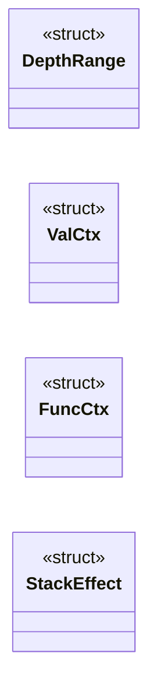
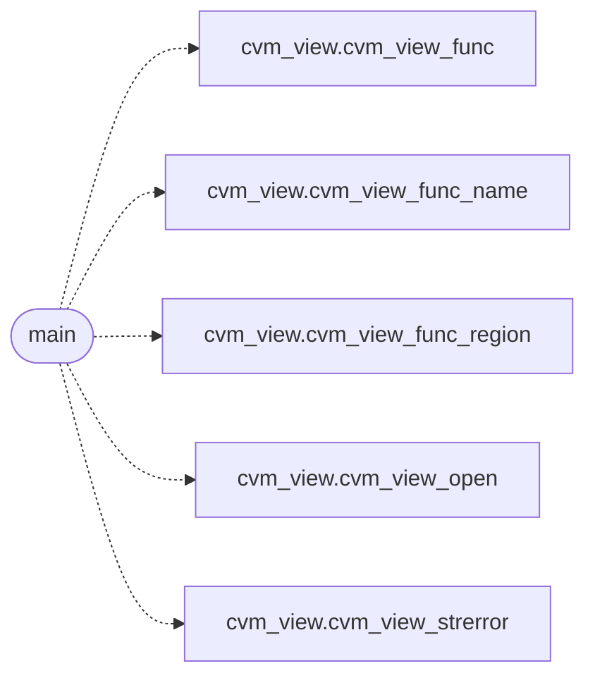

# `cvm2/cvm_val_main.c`

> Source: [cvm2/cvm_val_main.c:1](../../cvm2/cvm_val_main.c#L1) | language `c` | coverage 20.0% | [API index](../index.md)

## Contents

- **Structs:** [`DepthRange`](#depthrange), [`ValCtx`](#valctx), [`FuncCtx`](#funcctx), [`StackEffect`](#stackeffect)
- **Functions:** [`main`](#main)
- **Macros:** [`CVM_VAL_MAX_FUNCS`](#cvm_val_max_funcs), [`CVM_VAL_MAX_GLOBALS`](#cvm_val_max_globals), [`CVM_VAL_MAX_NATIVES`](#cvm_val_max_natives), [`CVM_VAL_MAX_CODE`](#cvm_val_max_code), [`CVM_VAL_MAX_LOCALS`](#cvm_val_max_locals), [`CVM_VAL_MAX_ARGS`](#cvm_val_max_args), [`CVM_VAL_STACK_CAP`](#cvm_val_stack_cap), [`CVM_VAL_WIDEN_BOUND`](#cvm_val_widen_bound), [`CVM_VAL_MAX_SARGS`](#cvm_val_max_sargs)

## Type Diagram



## Call Graph

Solid arrows stay in this module, dashed arrows leave it.



## Structs

<a id="depthrange"></a>

### `DepthRange`

`struct` | [cvm2/cvm_val_main.c:33](../../cvm2/cvm_val_main.c#L33)

```c
typedef struct
```

---

<a id="valctx"></a>

### `ValCtx`

`struct` | [cvm2/cvm_val_main.c:38](../../cvm2/cvm_val_main.c#L38)

```c
typedef struct
```

---

<a id="funcctx"></a>

### `FuncCtx`

`struct` | [cvm2/cvm_val_main.c:45](../../cvm2/cvm_val_main.c#L45)

```c
typedef struct
```

---

<a id="stackeffect"></a>

### `StackEffect`

`struct` | [cvm2/cvm_val_main.c:97](../../cvm2/cvm_val_main.c#L97)

```c
typedef struct
```

Stack effect of one instruction on the interval [lo,hi]: required pops, then the net deltas.

---

## Functions

<a id="main"></a>

### `main`

`function` | [cvm2/cvm_val_main.c:456](../../cvm2/cvm_val_main.c#L456)

```c
int main(int argc, char **argv)
```

**Parameters**

| Name | Type | Default | Description |
|---|---|---|---|
| `argc` | `int` |  |  |
| `argv` | `char **` |  |  |

**Returns:** `int`

*Calls:* [`cvm_view_func`](cvm2.cvm_view.h.md#cvm_view_func), [`cvm_view_func_name`](cvm2.cvm_view.h.md#cvm_view_func_name), [`cvm_view_func_region`](cvm2.cvm_view.h.md#cvm_view_func_region), [`cvm_view_open`](cvm2.cvm_view.h.md#cvm_view_open), [`cvm_view_strerror`](cvm2.cvm_view.h.md#cvm_view_strerror)

---

## Macros

<a id="cvm_val_max_funcs"></a>

### `CVM_VAL_MAX_FUNCS`

`macro` | [cvm2/cvm_val_main.c:15](../../cvm2/cvm_val_main.c#L15)

```c
#define CVM_VAL_MAX_FUNCS
```

---

<a id="cvm_val_max_globals"></a>

### `CVM_VAL_MAX_GLOBALS`

`macro` | [cvm2/cvm_val_main.c:16](../../cvm2/cvm_val_main.c#L16)

```c
#define CVM_VAL_MAX_GLOBALS
```

---

<a id="cvm_val_max_natives"></a>

### `CVM_VAL_MAX_NATIVES`

`macro` | [cvm2/cvm_val_main.c:17](../../cvm2/cvm_val_main.c#L17)

```c
#define CVM_VAL_MAX_NATIVES
```

---

<a id="cvm_val_max_code"></a>

### `CVM_VAL_MAX_CODE`

`macro` | [cvm2/cvm_val_main.c:18](../../cvm2/cvm_val_main.c#L18)

```c
#define CVM_VAL_MAX_CODE
```

---

<a id="cvm_val_max_locals"></a>

### `CVM_VAL_MAX_LOCALS`

`macro` | [cvm2/cvm_val_main.c:19](../../cvm2/cvm_val_main.c#L19)

```c
#define CVM_VAL_MAX_LOCALS
```

---

<a id="cvm_val_max_args"></a>

### `CVM_VAL_MAX_ARGS`

`macro` | [cvm2/cvm_val_main.c:20](../../cvm2/cvm_val_main.c#L20)

```c
#define CVM_VAL_MAX_ARGS
```

---

<a id="cvm_val_stack_cap"></a>

### `CVM_VAL_STACK_CAP`

`macro` | [cvm2/cvm_val_main.c:25](../../cvm2/cvm_val_main.c#L25)

```c
#define CVM_VAL_STACK_CAP
```

Saturation bound for the [lo,hi] stack-depth intervals: every pop needs at most CVM_VAL_MAX_ARGS items, so depths beyond this bound carry no further information, and saturating here makes loop-carried interval growth converge in a bounded number of passes.

---

<a id="cvm_val_widen_bound"></a>

### `CVM_VAL_WIDEN_BOUND`

`macro` | [cvm2/cvm_val_main.c:30](../../cvm2/cvm_val_main.c#L30)

```c
#define CVM_VAL_WIDEN_BOUND
```

Widening bound: depths beyond it are widened straight to the cap, because no pop ever needs more than CVM_VAL_MAX_ARGS items.

This makes loop-carried interval growth converge in a bounded number of worklist passes.

---

<a id="cvm_val_max_sargs"></a>

### `CVM_VAL_MAX_SARGS`

`macro` | [cvm2/cvm_val_main.c:31](../../cvm2/cvm_val_main.c#L31)

```c
#define CVM_VAL_MAX_SARGS
```

---
