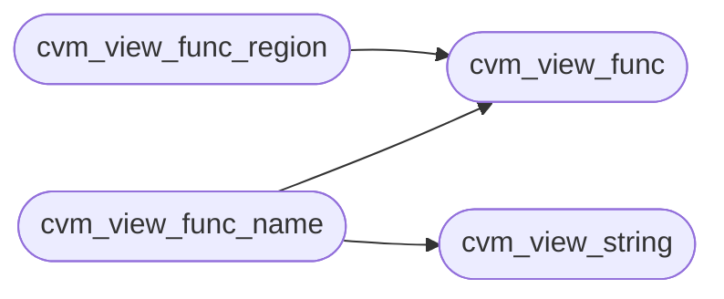

# `cvm2/cvm_view.c`

> Source: [cvm2/cvm_view.c:1](../../cvm2/cvm_view.c#L1) | language `c` | coverage 71.4% | [API index](../index.md)

## Contents

- **Functions:** [`cvm_view_strerror`](#cvm_view_strerror), [`cvm_view_open`](#cvm_view_open), [`cvm_view_func`](#cvm_view_func), [`cvm_view_string`](#cvm_view_string), [`cvm_view_func_name`](#cvm_view_func_name), [`cvm_view_func_region`](#cvm_view_func_region)

## Call Graph

Solid arrows stay in this module, dashed arrows leave it.



## Functions

<a id="cvm_view_strerror"></a>

### `cvm_view_strerror`

`function` `const` | [cvm2/cvm_view.c:18](../../cvm2/cvm_view.c#L18)

```c
const char *cvm_view_strerror(int error_code)
```

Message for an error code returned by cvm_view_open.

**Parameters**

| Name | Type | Default | Description |
|---|---|---|---|
| `error_code` | `int` |  |  |

**Returns:** `char *`

> **Inherited:** Documentation from [`cvm_view_strerror`](#cvm_view_strerror) (cvm2/cvm_view.h:44).

---

<a id="cvm_view_open"></a>

### `cvm_view_open`

`function` | [cvm2/cvm_view.c:29](../../cvm2/cvm_view.c#L29)

```c
int cvm_view_open(CvmModuleView *v, const uint8_t *data, size_t size)
```

Parse and validate the header plus all section extents.

**Parameters**

| Name | Type | Default | Description |
|---|---|---|---|
| `v` | `CvmModuleView *` |  |  |
| `data` | `uint8_t *` |  |  |
| `size` | `size_t` |  |  |

**Returns:** `int`

> **Inherited:** Documentation from [`cvm_view_open`](#cvm_view_open) (cvm2/cvm_view.h:41).

---

<a id="cvm_view_func"></a>

### `cvm_view_func`

`function` `const` | [cvm2/cvm_view.c:72](../../cvm2/cvm_view.c#L72)

```c
const CvmFuncEntry *cvm_view_func(const CvmModuleView *v, uint32_t i)
```

**Parameters**

| Name | Type | Default | Description |
|---|---|---|---|
| `v` | `CvmModuleView *` |  |  |
| `i` | `uint32_t` |  |  |

**Returns:** `CvmFuncEntry *`

*Called by:* [`cvm_view_func_name`](#cvm_view_func_name), [`cvm_view_func_region`](#cvm_view_func_region)

---

<a id="cvm_view_string"></a>

### `cvm_view_string`

`function` `const` | [cvm2/cvm_view.c:78](../../cvm2/cvm_view.c#L78)

```c
const char *cvm_view_string(const CvmModuleView *v, uint32_t off)
```

String from the pool, or NULL when the offset is outside it.

The pointer is only valid while the module data lives.

**Parameters**

| Name | Type | Default | Description |
|---|---|---|---|
| `v` | `CvmModuleView *` |  |  |
| `off` | `uint32_t` |  |  |

**Returns:** `char *`

> **Inherited:** Documentation from [`cvm_view_string`](#cvm_view_string) (cvm2/cvm_view.h:50).

*Called by:* [`cvm_view_func_name`](#cvm_view_func_name)

---

<a id="cvm_view_func_name"></a>

### `cvm_view_func_name`

`function` `const` | [cvm2/cvm_view.c:87](../../cvm2/cvm_view.c#L87)

```c
const char *cvm_view_func_name(const CvmModuleView *v, uint32_t fi, char *fallback, size_t cap)
```

Function name from the pool; falls back to "func<N>" in fallback.

**Parameters**

| Name | Type | Default | Description |
|---|---|---|---|
| `v` | `CvmModuleView *` |  |  |
| `fi` | `uint32_t` |  |  |
| `fallback` | `char *` |  |  |
| `cap` | `size_t` |  |  |

**Returns:** `char *`

> **Inherited:** Documentation from [`cvm_view_func_name`](#cvm_view_func_name) (cvm2/cvm_view.h:53).

*Calls:* [`cvm_view_func`](#cvm_view_func), [`cvm_view_string`](#cvm_view_string)

---

<a id="cvm_view_func_region"></a>

### `cvm_view_func_region`

`function` | [cvm2/cvm_view.c:108](../../cvm2/cvm_view.c#L108)

```c
int cvm_view_func_region(const CvmModuleView *v, uint32_t fi, size_t *begin, size_t *end)
```

Code region of a function: [*begin, *end) where *end is the next function's code offset or the end of the code section.

**Parameters**

| Name | Type | Default | Description |
|---|---|---|---|
| `v` | `CvmModuleView *` |  |  |
| `fi` | `uint32_t` |  |  |
| `begin` | `size_t *` |  |  |
| `end` | `size_t *` |  |  |

**Returns:** `int`

> **Inherited:** Documentation from [`cvm_view_func_region`](#cvm_view_func_region) (cvm2/cvm_view.h:58).

*Calls:* [`cvm_view_func`](#cvm_view_func)

---
