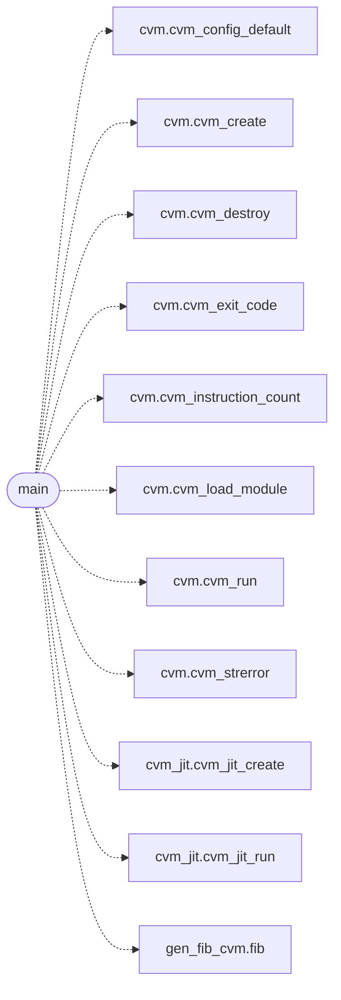

# `cvm2/gen_fib_cvm.c`

> Source: [cvm2/gen_fib_cvm.c:1](../../cvm2/gen_fib_cvm.c#L1) | language `c` | coverage 0.0% | [API index](../index.md)

## Contents

- **Functions:** [`main`](#main)
- **Macros:** [`FIB_N`](#fib_n), [`EXPECTED_FIB10`](#expected_fib10), [`EXPECTED_CALLS`](#expected_calls)

## Call Graph

Solid arrows stay in this module, dashed arrows leave it.



## Functions

<a id="main"></a>

### `main`

`function` | [cvm2/gen_fib_cvm.c:64](../../cvm2/gen_fib_cvm.c#L64)

```c
int main(int argc, char *argv[])
```

**Parameters**

| Name | Type | Default | Description |
|---|---|---|---|
| `argc` | `int` |  |  |
| `argv` | `char * []` |  |  |

**Returns:** `int`

*Calls:* [`cvm_config_default`](cvm2.cvm.c.md#cvm_config_default), [`cvm_create`](cvm2.cvm.h.md#cvm_create), [`cvm_destroy`](cvm2.cvm.h.md#cvm_destroy), [`cvm_exit_code`](cvm2.cvm.h.md#cvm_exit_code), [`cvm_instruction_count`](cvm2.cvm.h.md#cvm_instruction_count), [`cvm_load_module`](cvm2.cvm.h.md#cvm_load_module), [`cvm_run`](cvm2.cvm.h.md#cvm_run), [`cvm_strerror`](cvm2.cvm.h.md#cvm_strerror), [`cvm_jit_create`](cvm2.cvm_jit.h.md#cvm_jit_create), [`cvm_jit_run`](cvm2.cvm_jit.h.md#cvm_jit_run), [`fib`](gen_fib_cvm.c.md#fib)

---

## Macros

<a id="fib_n"></a>

### `FIB_N`

`macro` | [cvm2/gen_fib_cvm.c:13](../../cvm2/gen_fib_cvm.c#L13)

```c
#define FIB_N
```

---

<a id="expected_fib10"></a>

### `EXPECTED_FIB10`

`macro` | [cvm2/gen_fib_cvm.c:14](../../cvm2/gen_fib_cvm.c#L14)

```c
#define EXPECTED_FIB10
```

---

<a id="expected_calls"></a>

### `EXPECTED_CALLS`

`macro` | [cvm2/gen_fib_cvm.c:15](../../cvm2/gen_fib_cvm.c#L15)

```c
#define EXPECTED_CALLS
```

---
