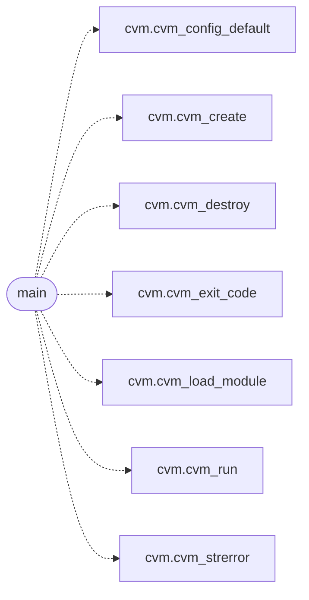

# `cvm2/gen_minimal.c`

> Source: [cvm2/gen_minimal.c:1](../../cvm2/gen_minimal.c#L1) | language `c` | coverage 0.0% | [API index](../index.md)

## Contents

- **Functions:** [`main`](#main)

## Call Graph

Solid arrows stay in this module, dashed arrows leave it.



## Functions

<a id="main"></a>

### `main`

`function` | [cvm2/gen_minimal.c:30](../../cvm2/gen_minimal.c#L30)

```c
int main(void)
```

**Returns:** `int`

*Calls:* [`cvm_config_default`](cvm2.cvm.c.md#cvm_config_default), [`cvm_create`](cvm2.cvm.h.md#cvm_create), [`cvm_destroy`](cvm2.cvm.h.md#cvm_destroy), [`cvm_exit_code`](cvm2.cvm.h.md#cvm_exit_code), [`cvm_load_module`](cvm2.cvm.h.md#cvm_load_module), [`cvm_run`](cvm2.cvm.h.md#cvm_run), [`cvm_strerror`](cvm2.cvm.h.md#cvm_strerror)

---
