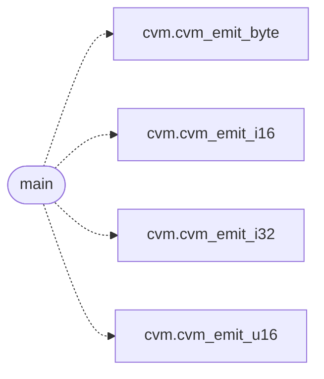

# `gen_fib_cvm.c`

> Source: [gen_fib_cvm.c:1](../../gen_fib_cvm.c#L1) | language `c` | coverage 0.0% | [API index](../index.md)

## Contents

- **Functions:** [`fib`](#fib), [`main`](#main)

## Call Graph

Solid arrows stay in this module, dashed arrows leave it.



## Functions

<a id="fib"></a>

### `fib`

`function` | [gen_fib_cvm.c:7](../../gen_fib_cvm.c#L7)

```c
* return fib(n-1) + fib(n-2);
```

**Parameters**

| Name | Type | Default | Description |
|---|---|---|---|
| `n` |  |  |  |

**Returns:** `* return`

*Called by:* [`main`](cvm2.gen_fib_cvm.c.md#main)

---

<a id="main"></a>

### `main`

`function` | [gen_fib_cvm.c:36](../../gen_fib_cvm.c#L36)

```c
int main(void)
```

**Returns:** `int`

*Calls:* [`cvm_emit_byte`](cvm.h.md#cvm_emit_byte), [`cvm_emit_i16`](cvm.h.md#cvm_emit_i16), [`cvm_emit_i32`](cvm.h.md#cvm_emit_i32), [`cvm_emit_u16`](cvm.h.md#cvm_emit_u16)

---
