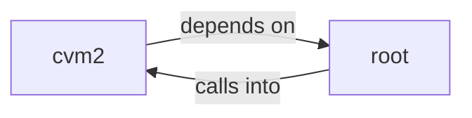

# cvm2: cvm

cvm2: cvm groups 12 files (c, h) around CVM_H, CvmOpcode, CVM_MAGIC_0, CVM_MAGIC_1, CVM_MAGIC_2. cvm_error: — C Virtual Machine interpreter  #include "cvm.h" #include <stdarg.h>...

## cvm2 (1.1)

cvm2 groups 9 files (c, h) around CVM_H, CvmOpcode, CVM_MAGIC_0, CVM_MAGIC_1, CVM_MAGIC_2. Vout: static int64_t native_atol(void *vm, int ac, uint64_t *av) { (void)vm; if (ac <...

## root (1.2)

root groups 3 files (c, h) around CVM_H, CVM_MAGIC, CVM_VERSION, CVM_Header, CVM_FuncEntry. cvm_error: — C Virtual Machine interpreter  #include "cvm.h" #include <stdarg.h>...

**Files**:

- cvm.c
- cvm.h
- cvm2/cvm.c
- cvm2/cvm.h
- cvm2/cvm_jit.h
- cvm2/cvm_jit_help.c
- cvm2/cvm_jit_help.h
- cvm2/cvm_jit_x86.c
- cvm2/cvm_jit_x86.h
- cvm2/gen_fib_cvm.c
- cvm2/gen_minimal.c
- gen_fib_cvm.c
