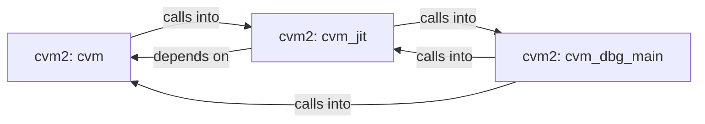

## Details

Static architecture map of 26 files (c, h, py, sh) in 3 components: cvm2: cvm, cvm2: cvm_dbg_main, cvm2: cvm_jit. Structure is extracted statically without LLM calls; component prose may be enriched locally.

### cvm2: cvm (1)

cvm2: cvm groups 12 files (c, h) around CVM_H, CvmOpcode, CVM_MAGIC_0, CVM_MAGIC_1, CVM_MAGIC_2. cvm_error: — C Virtual Machine interpreter  #include "cvm.h" #include <stdarg.h>...

**Related Classes/Methods**:

- <a href="../cvm2/cvm.h#L28-L37">cvm2/cvm.h::CVM_H</a>
- <a href="../cvm2/cvm.h#L38-L40">cvm2/cvm.h::CvmOpcode</a>
- <a href="../cvm2/cvm.h">cvm2/cvm.h::CVM_MAGIC_0</a>
- <a href="../cvm2/cvm.h">cvm2/cvm.h::CVM_MAGIC_1</a>
- <a href="../cvm2/cvm.h">cvm2/cvm.h::CVM_MAGIC_2</a>
- <a href="../cvm2/cvm.h">cvm2/cvm.h::CVM_MAGIC_3</a>
- <a href="../cvm2/cvm.h">cvm2/cvm.h::CVM_VERSION_MAJOR</a>
- <a href="../cvm2/cvm.h">cvm2/cvm.h::CVM_VERSION_MINOR</a>

### cvm2: cvm_dbg_main (2)

cvm2: cvm_dbg_main groups 5 files (c, h) around CVM_VIEW_H, data, CvmModuleView, cvm_view_open, cvm_view_strerror. cvm_dis_module: #ifndef CVM_DIS_H #define CVM_DIS_H #include <stddef.h> #include...

**Related Classes/Methods**:

- <a href="../cvm2/cvm_view.h#L9-L15">cvm2/cvm_view.h::CVM_VIEW_H</a>
- <a href="../cvm2/cvm_view.h#L16-L18">cvm2/cvm_view.h::data</a>
- <a href="../cvm2/cvm_view.h#L19-L40">cvm2/cvm_view.h::CvmModuleView</a>
- <a href="../cvm2/cvm_view.h#L41-L43">cvm2/cvm_view.h::cvm_view_open</a>
- <a href="../cvm2/cvm_view.h#L44-L45">cvm2/cvm_view.h::cvm_view_strerror</a>
- <a href="../cvm2/cvm_view.h#L46-L49">cvm2/cvm_view.h::cvm_view_func</a>
- <a href="../cvm2/cvm_view.h#L50-L52">cvm2/cvm_view.h::cvm_view_string</a>
- <a href="../cvm2/cvm_view.h#L53-L57">cvm2/cvm_view.h::cvm_view_func_name</a>

### cvm2: cvm_jit (3)

cvm2: cvm_jit groups 5 files (c, h) around CVM_OPS_H, CvmOpKind, CvmOpInfo, cvm_op_info, cvm_op_name. emit_stack_pop_into: /* Push rax onto the operand stack: slots[sp] = rax; sp++ static...

**Related Classes/Methods**:

- <a href="../cvm2/cvm_ops.h#L10-L15">cvm2/cvm_ops.h::CVM_OPS_H</a>
- <a href="../cvm2/cvm_ops.h#L16-L29">cvm2/cvm_ops.h::CvmOpKind</a>
- <a href="../cvm2/cvm_ops.h#L30-L37">cvm2/cvm_ops.h::CvmOpInfo</a>
- <a href="../cvm2/cvm_ops.h#L38-L40">cvm2/cvm_ops.h::cvm_op_info</a>
- <a href="../cvm2/cvm_ops.h#L41-L43">cvm2/cvm_ops.h::cvm_op_name</a>
- <a href="../cvm2/cvm_ops.h">cvm2/cvm_ops.h::cvm_ops_ri32</a>
- <a href="../cvm2/cvm_ops.h">cvm2/cvm_ops.h::cvm_ops_ri64</a>
- <a href="../cvm2/cvm_ops.h">cvm2/cvm_ops.h::cvm_ops_ru32</a>
